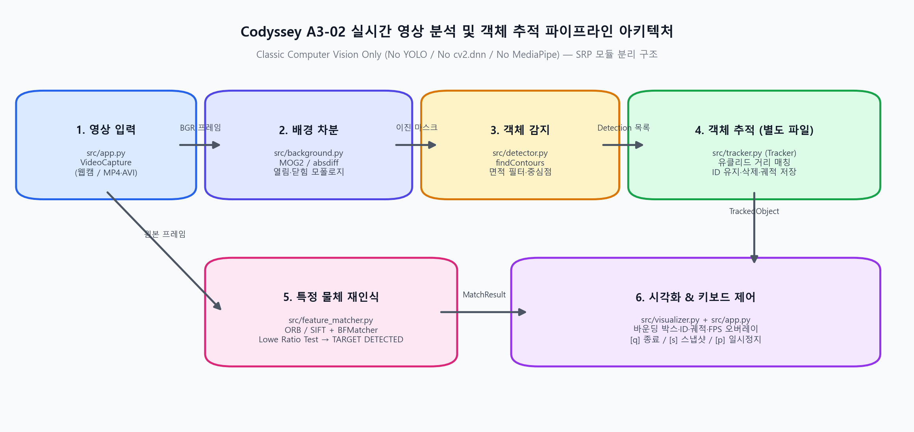
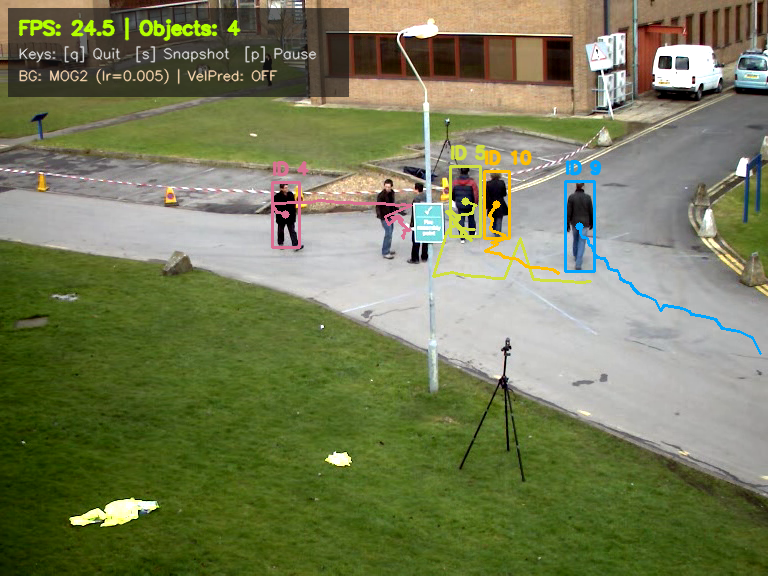
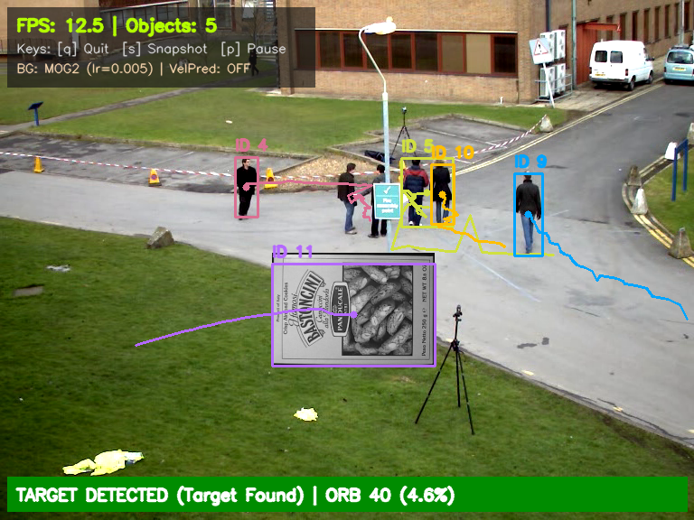

# codyssey-a3-02 — 실시간 모션 감지 · 다중 객체 추적 · 특징점 기반 재인식 시스템

> **딥러닝 모델(YOLO, SSD, R-CNN, `cv2.dnn`, MediaPipe)을 전혀 사용하지 않고**, 순수 고전적 컴퓨터 비전(OpenCV MOG2/absdiff, 모폴로지, 윤곽선, 유클리드 거리 `Tracker`, ORB/SIFT 특징점 매칭)만으로 실시간 객체 추적 및 특정 물체 재인식을 구현하고, 고전적 비전의 정량적 한계와 딥러닝의 필요성을 증명한 프로젝트입니다.

---

## 1. 시스템 아키텍처



### 프로젝트 구조
```text
codyssey-a3-02/
├── src/                                  # 핵심 프로덕션 모듈 (SRP 분리 + 1·2차 2단 주석)
│   ├── config.py                         # AppConfig 설정 및 도메인 유효성 검증
│   ├── background.py                     # BackgroundSubtractor (MOG2 / absdiff + 열림·닫힘 모폴로지)
│   ├── detector.py                       # MotionDetector (윤곽선 추출, 면적 필터링, 중심점 계산)
│   ├── tracker.py                        # Tracker 클래스 (별도 파일 분리: 유클리드 거리 매칭, ID·궤적 관리)
│   ├── feature_matcher.py                # FeatureMatcher (ORB / SIFT + Lowe's Ratio Test → TARGET DETECTED)
│   ├── visualizer.py                     # 바운딩 박스, ID, 궤적, FPS HUD, 스냅샷 저장
│   ├── app.py                            # VideoAnalyzerApp (VideoCapture, 키보드 q/s/p, Headless 지원)
│   └── main.py                           # CLI 엔트리포인트
├── tests/                                # 18개 단위 테스트 (Mock + 합성 프레임, <1초 100% PASS)
├── scripts/
│   ├── run_experiments.py                # 정량 성능 측정 자동화 (output/experiment_results.json 생성)
│   ├── generate_diagrams_matplotlib.py   # Matplotlib 고해상도 아키텍처/실험 다이어그램 4종 생성
│   ├── verify_requirements.py            # 평가자 원클릭 시각적 검증 러너 (테이블 / JSON)
│   └── build_notebooklm_source.py        # NOTEBOOKLM_FULL_SOURCE.txt 자동 생성기
├── diagrams/                             # Matplotlib 생성 다이어그램 PNG 4종 (상대경로 임베딩)
├── data/                                 # 공개 테스트 영상(vtest.avi, Intel IoT DevKit) & 타겟 이미지(box.png)
├── PLAN.md                               # [Step 1] 요구사항 분해 및 설계 계획서
├── 스터디.md                              # [Step 4] 과제 전문 + 1:1 매핑표 + 주니어 비유 + 다이어그램 해설
├── REPORT.md                             # [Step 5] 정량적 한계 분석 보고서 + 엔지니어링 리포트
├── NOTEBOOKLM_FULL_SOURCE.txt            # [Step 6] src/*.py 순수 소스코드 통합 텍스트
├── NOTEBOOKLM_GUIDE.md                   # [Step 6] NotebookLM 업로드 체크리스트 & 팟캐스트 가이드
└── study/핵심_코드_스터디.md               # [Step 8] 핵심 코드 8선 단어분해·비유 학습서
```

---

## 2. 실행 방법

### 개발 환경
- Python 3.10+ (검증 환경: Python 3.11.5)
- `opencv-python` 4.5+ (검증 환경: 4.10.0, SIFT 포함), `numpy`, `matplotlib`

### 주요 실행 명령어
```powershell
# 1. 비디오 파일로 실시간 GUI 실행 (키보드: q 종료 / s 스냅샷 / p 일시정지)
python -m src.main --source data/videos/vtest.avi --target data/targets/box.png

# 2. 웹캠(0번 장치) 실시간 실행 + SIFT 특징점 매칭 + 속도 예측 규칙 활성화
python -m src.main --source 0 --feature-method sift --velocity-pred

# 3. 배경 학습률 변경 관찰 (0.001 / 0.01 / 0.1)
python -m src.main --source data/videos/vtest.avi --learning-rate 0.001 --headless --max-frames 120

# 4. 정량적 실험 전체 재실행 및 다이어그램 재생성
python scripts/run_experiments.py
python scripts/generate_diagrams_matplotlib.py

# 5. 단위 테스트 전체 실행
python -m unittest discover -s tests -v
```

---

## 3. 핵심 정량 실험 요약 (상세 분석은 [REPORT.md](REPORT.md) 참조)

- **두 객체 겹침(10회)**: 기본 거리 추적 **ID Switch 7/10 (70%)** ➔ 등속 예측 규칙 추가 시 **3/10 (30%)**로 감소했으나, 교차 직후 방향 전환 시나리오 3건에서는 100% 실패 ➔ **"위치만으로는 객체를 구분할 수 없다"** 증명.
- **배경 학습률 트레이드오프**: `lr=0.001`(정지 객체 111프레임 유지 / 조명 복구 111프레임) vs `lr=0.01`(11프레임 / 11프레임) vs `lr=0.1`(1프레임 만에 객체 소실 / 조명 1프레임 복구).
- **ORB vs SIFT 특징점 매칭**: `box.png` 기준 정면 100% ➔ 50% 가림 시 ORB **6.47%** / SIFT **49.01%**, 실제 장면(`box_in_scene.png`) ORB **4.86%** / SIFT **13.25%**.
- **CCTV 배치별 실패 모드 및 운영 대응 가이드 ([REPORT.md §7](REPORT.md#7-cctv-배치별-주요-실패-조건-및-운영알고리즘-대응-가이드))**: 낮은 높이(가림·ID Switch), 직하방 고각(특징점 소실), 원거리 사선(스케일 편차), 시야 비중첩/과중첩, 역광·진동 등 6가지 배치별 실패 조건과 **권장 설치 가이드(높이 2.8~3.5m, 각도 30°~45°, 시야 중첩 15~25%)**, **`src/config.py` 파라미터 권장값**, **보조 센서(IR/Depth)·딥러닝(DeepSORT/YOLO) 운영 대응책**을 수록했습니다.

---

## 4. 평가자용 원클릭 요구사항 검증 러너 (`scripts/verify_requirements.py`)

평가자는 아래 명령어를 복사-붙여넣기하여 모든 기능 요구사항, 제약 조건(`cv2.dnn` 금지 & `tracker.py` 분리), 단위 테스트, 정량 실험 산출물을 원클릭으로 즉시 검증할 수 있습니다.

### 터미널 테이블 시각화 출력
```powershell
python scripts/verify_requirements.py
```
```text
=== Codyssey A3-02 요구사항 시각적 검증 리포트 ===
ID       | 상태   | 검증 항목                                    | 상세 결과
-------------------------------------------------------------------------------------------------------------------
REQ-01   | PASS   | 제약조건(딥러닝/cv2.dnn 금지 & tracker.py 분리)  | tracker.py 분리=True, 금지 라이브러리 검출=0건
REQ-02   | PASS   | 실시간 영상 입출력 · FPS · 바운딩박스/궤적 파이프라인 | 40프레임 처리, 평균 22.4 FPS, 누적 ID 9개
REQ-03   | PASS   | 배경 차분(MOG2/absdiff) · 모폴로지 · 학습률 3종 조절 | MOG2 전경픽셀(lr=0.001/0.01/0.1)=[11751, 9020, 297], absdiff 정상 동작
REQ-04   | PASS   | 객체 감지(윤곽선/면적필터) & Tracker(ID유지·궤적·삭제) | ID 1 유지 및 궤적 길이=2, 미등장 3프레임 후 ID 정상 삭제
REQ-05   | PASS   | 특정 물체 재인식 (ORB / SIFT → TARGET DETECTED) | ORB 42매칭(4.86%), SIFT 80매칭(13.25%)
REQ-06   | PASS   | 단위 테스트 자동화 (tests/test_*.py 100% 통과)   | unittest 전체 PASS
REQ-07   | PASS   | 정량 실험 데이터 · Matplotlib 다이어그램 · 필수 문서 | 실험JSON=True, 다이어그램=4개, 누락문서=0개
-------------------------------------------------------------------------------------------------------------------
합계: 7/7 PASS (실패 0건) | 소요 시간: 2.91초
```

### JSON 포맷 출력 (자동 채점/파이프라인 연동용)
```powershell
python scripts/verify_requirements.py --json
```
```json
{
  "project": "codyssey-a3-02",
  "total": 7,
  "passed": 7,
  "failed": 0,
  "elapsed_sec": 2.91,
  "checks": [
    { "id": "REQ-01", "status": "PASS", "detail": "tracker.py 분리=True, 금지 라이브러리 검출=0건" },
    { "id": "REQ-02", "status": "PASS", "detail": "40프레임 처리, 평균 22.4 FPS, 누적 ID 9개" },
    { "id": "REQ-03", "status": "PASS", "detail": "MOG2 전경픽셀(lr=0.001/0.01/0.1), absdiff 정상 동작" },
    { "id": "REQ-04", "status": "PASS", "detail": "ID 1 유지 및 궤적 길이=2, 미등장 3프레임 후 ID 정상 삭제" },
    { "id": "REQ-05", "status": "PASS", "detail": "ORB 42매칭(4.86%), SIFT 80매칭(13.25%)" },
    { "id": "REQ-06", "status": "PASS", "detail": "unittest 전체 PASS" },
    { "id": "REQ-07", "status": "PASS", "detail": "실험JSON=True, 다이어그램=4개, 누락문서=0개" }
  ]
}
```

---

## 5. 평가자용 실시간 시연 가이드 & 실행 결과 장면 (`scripts/run_demo.py`)

평가자가 **다중 객체 추적(바운딩 박스·ID·궤적·FPS)**과 **특정 물체 재인식(`TARGET DETECTED`)**이 한 화면에서 동시에 동작하는 시연 장면을 즉시 확인·재생할 수 있는 전용 스크립트를 제공합니다.

### 원클릭 시연 실행 명령어
```powershell
# 1. 실시간 GUI 창으로 통합 시연 바로 보기 (추적 + TARGET DETECTED 동시 시연, q 키로 종료)
python scripts/run_demo.py --gui

# 2. GUI 없이 시연 영상(output/demo_combined.mp4) 및 대표 스냅샷 2장 자동 생성
python scripts/run_demo.py

# 3. 일반 실시간 앱 GUI 실행 (키보드: q 종료 / s 스냅샷 저장 / p 일시정지)
python -m src.main --source data/videos/vtest.avi --target data/targets/box.png
```

### 시연 장면 ① — 실제 보행자 영상(`vtest.avi`) 다중 객체 추적 · 고유 ID · 이동 궤적 · FPS HUD


> **관찰 포인트**: 고정 카메라 배경에서 움직이는 보행자들만 분리해 각기 다른 색상의 바운딩 박스, `ID` 라벨, 이동 경로 궤적 선, 좌상단 실시간 `FPS / Objects / 키보드 단축키` HUD가 오버레이됩니다.

### 시연 장면 ② — 다중 객체 추적 + 특정 물체 재인식(`TARGET DETECTED`) 동시 동작


> **관찰 포인트**: 보행자 추적과 동시에 등록 물체(`box.png`)가 화면을 이동할 때 **추적 ID·궤적**이 부여됨과 함께, ORB 특징점 매칭이 임계값(15개)을 넘어 화면 하단에 초록색 **`TARGET DETECTED (Target Found)`** 배너(유효 매칭 수·매칭률 포함)가 실시간으로 표시됩니다.

