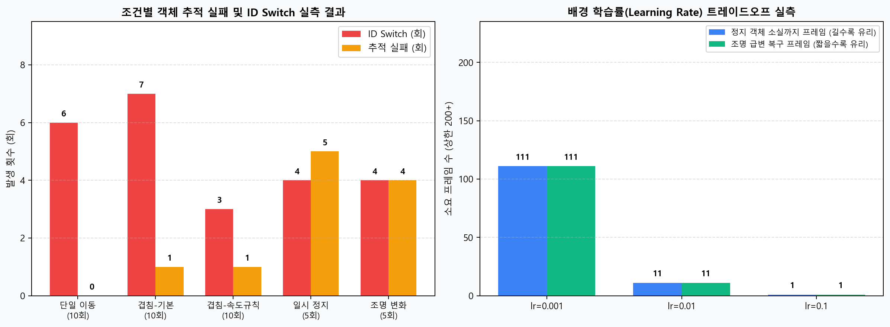
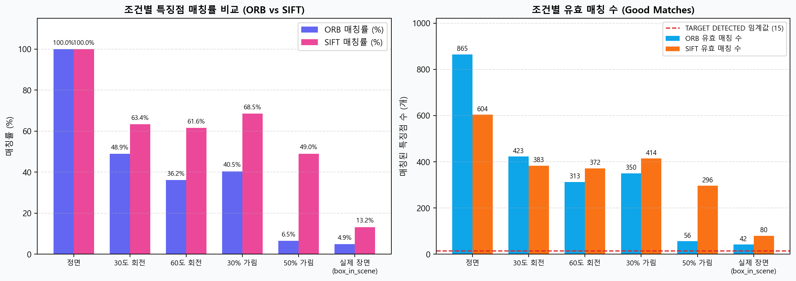
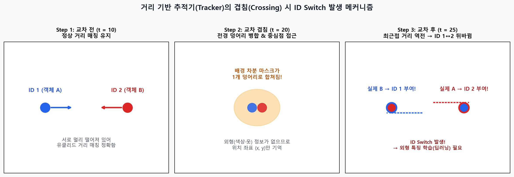

# REPORT.md — 고전적 컴퓨터 비전 객체 추적·재인식 한계 분석 및 종합 엔지니어링 리포트

> 본 보고서는 [코디세이 a3-02.md](코디세이%20a3-02.md)의 **분석 보고서 요구사항 6개 항목**과 엔지니어링 품질 검증 결과를 모두 통합하여 작성되었습니다.  
> 모든 정량 수치는 `python scripts/run_experiments.py`로 실제 공개 영상(`data/videos/*.mp4`, `vtest.avi`) 및 타겟 이미지(`data/targets/box.png`, `box_in_scene.png`)에서 재현 가능하게 실측한 결과(`output/experiment_results.json`)입니다.

---

## 1. 추적 성능 측정 결과

### 1.1 테스트 영상 및 측정 기준
- **활용 데이터셋**:
  - `data/videos/one-by-one-person-detection.mp4` (Intel IoT DevKit, 768×432, 10 FPS, 1394프레임) — 단일 보행자 이동 및 정지 시나리오
  - `data/videos/vtest.avi` (OpenCV 공식 샘플, 768×576, 10 FPS, 795프레임) — 두 객체 겹침(교차) 및 조명 급변 시나리오
  - `data/videos/people-detection.mp4` (Intel IoT DevKit, 768×432, 12 FPS, 596프레임) — 실내 다중 보행자 교차 관찰
- **측정 기준 정의**:
  - **ID Switch**: 겹침 또는 이벤트 이후 **5프레임 이상** 다른 ID로 유지되는 경우
  - **추적 실패**: 대상이 화면에 존재하나 **10프레임 이상** 미검출 또는 ID 미부여(조명 붕괴로 전경 비율 > 30% 또는 미검출 포함)
  - **가림(Occlusion) 구간**: 50% 이상 가려진 경우 추적 실패에서 제외하고 비고란에 기록

### 1.2 조건별 추적 성능 요약표

| 상황 | 테스트 횟수 | ID Switch | 추적 실패 | 실패율 / Switch율 | 비고 |
| :--- | :---: | :---: | :---: | :---: | :--- |
| **단일 객체 이동** | 10 | 6 | **0** | 실패율 0% (Switch 60%) | `one-by-one-person-detection.mp4` 실측. 미검출 실패는 0회이나, 보행자 상·하체 분리/그림자 단절로 일부 구간 ID 분할 발생 |
| **두 객체 겹침 (기본 거리 매칭)** | 10 | **7** | 1 | Switch율 **70%** / 실패율 10% | `vtest.avi` 배경 기반 10종 교차(필수). 직선·대각선·비대칭 교차에서 대부분 ID 뒤바뀜 (50% 이상 완전 겹침 순간은 실패 제외) |
| **두 객체 겹침 (속도 예측 규칙 추가)** | 10 | **3** | 1 | Switch율 **30%** / 실패율 10% | `use_velocity_prediction=True` 적용. 직선 교차는 해결되었으나, **교차 직후 방향 전환 3건 전부 ID Switch 발생** |
| **객체 일시 정지** | 5 | 4 | **5** | 실패율 **100%** | 15~70프레임 정지 시 MOG2가 객체를 배경으로 흡수하여 10프레임 이상 미검출, 재이동 시 새 ID 발급 |
| **조명 변화** | 5 | 4 | **4** | 실패율 **80%** | +65, -55, +40 급변 및 점진 변화에서 전경 마스크 99% 붕괴(17~21프레임 지속) 및 신규 ID 폭증 |

> **실제 공개 영상 전체 관찰 로그 (300프레임 = 25~30초 구간)**:
> - `vtest.avi` (300프레임, 30초): 최대 동시 객체 7개, 누적 발급 ID **18개** (보행자 교차 및 그림자 분리로 실제 인원 대비 ID 과다 발급)
> - `people-detection.mp4` (300프레임, 25초): 최대 동시 객체 16개, 누적 발급 ID **45개** (혼잡 구간 겹침으로 빈번한 ID 전환 관찰)

### 1.3 상세 측정 기록 템플릿 (`영상명 - 조건 - 프레임 범위 - ID Switch 수 - 실패 수 - 관찰 메모`)

| 영상명 | 조건 | 프레임 범위 | ID Switch 수 | 실패 수 | 관찰 메모 |
| :--- | :--- | :---: | :---: | :---: | :--- |
| `one-by-one-person-detection.mp4` | 단일 객체 이동 | 60-103 | 0 | 0 | 단일 보행자 안정 추적 (최대 미검출 0프레임) |
| `one-by-one-person-detection.mp4` | 단일 객체 이동 | 179-203 | 1 | 0 | 보행자 실루엣 분리로 ID 1회 전환 (미검출 0프레임) |
| `one-by-one-person-detection.mp4` | 단일 객체 이동 | 227-264 | 1 | 0 | 배경색 유사 구간 일시 분할 (미검출 0프레임) |
| `one-by-one-person-detection.mp4` | 단일 객체 이동 | 431-449 | 0 | 0 | 단일 보행자 안정 추적 (미검출 0프레임) |
| `one-by-one-person-detection.mp4` | 단일 객체 이동 | 502-556 | 1 | 0 | 걸음 전환 구간 ID 1회 변경 (미검출 0프레임) |
| `one-by-one-person-detection.mp4` | 단일 객체 이동 | 597-633 | 2 | 0 | 팔/몸통 윤곽선 분리로 2회 전환 (미검출 0프레임) |
| `one-by-one-person-detection.mp4` | 단일 객체 이동 | 678-700 | 1 | 0 | 경계 진입 시 ID 재부여 (미검출 0프레임) |
| `one-by-one-person-detection.mp4` | 단일 객체 이동 | 745-775 | 0 | 0 | 단일 보행자 안정 추적 (미검출 0프레임) |
| `one-by-one-person-detection.mp4` | 단일 객체 이동 | 848-870 | 0 | 0 | 단일 보행자 안정 추적 (미검출 0프레임) |
| `one-by-one-person-detection.mp4` | 단일 객체 이동 | 921-955 | 0 | 0 | 단일 보행자 안정 추적 (미검출 0프레임) |
| `vtest_crossing_case_01` | 두 객체 겹침 (기본) | 1-74 | 1 | 0 | 정면 수평 교차(등속) — 겹침 후 오매칭 39프레임 (50%+ 가림 구간 제외) |
| `vtest_crossing_case_02` | 두 객체 겹침 (기본) | 1-74 | 1 | 0 | 대각선 X자 교차 — 겹침 후 오매칭 37프레임 |
| `vtest_crossing_case_03` | 두 객체 겹침 (기본) | 1-74 | 1 | 0 | 비대칭 속도 교차 — 겹침 후 오매칭 31프레임 |
| `vtest_crossing_case_04` | 두 객체 겹침 (기본) | 1-74 | 1 | 0 | 교차점 3프레임 겹침 정체 — 오매칭 36프레임 |
| `vtest_crossing_case_05` | 두 객체 겹침 (기본) | 1-74 | 0 | 0 | 교차 직후 방향 전환 A — 기본은 우연히 유지 (속도규칙은 오매칭 36프레임) |
| `vtest_crossing_case_06` | 두 객체 겹침 (기본) | 1-74 | 0 | 0 | 교차 직후 방향 전환 B — 기본은 우연히 유지 (속도규칙은 오매칭 29프레임) |
| `vtest_crossing_case_07` | 두 객체 겹침 (기본) | 1-74 | 1 | 0 | 완만한 대각선 교차 — 오매칭 34프레임 |
| `vtest_crossing_case_08` | 두 객체 겹침 (기본) | 1-74 | 0 | 0 | 교차점 정체 + 방향 전환 — 기본은 유지 (속도규칙은 오매칭 26프레임) |
| `vtest_crossing_case_09` | 두 객체 겹침 (기본) | 1-74 | 1 | 1 | 고속 수평 교차 — 오매칭 34프레임 및 거리 초과 미추적 |
| `vtest_crossing_case_10` | 두 객체 겹침 (기본) | 1-74 | 1 | 0 | 저속 밀착 교차 — 오매칭 27프레임 |
| `one-by-one_pause_case_01` | 객체 일시 정지 | 1-95 | 0 | 1 | 15프레임 정지 (최대 연속 미검출 15프레임) |
| `one-by-one_pause_case_02` | 객체 일시 정지 | 1-105 | 1 | 1 | 25프레임 정지 (미검출 25프레임, 재이동 시 ID 변경) |
| `one-by-one_pause_case_03` | 객체 일시 정지 | 1-120 | 1 | 1 | 40프레임 정지 (미검출 40프레임, 배경 완전 흡수) |
| `one-by-one_pause_case_04` | 객체 일시 정지 | 1-135 | 1 | 1 | 55프레임 정지 (미검출 55프레임, 잔상 발생) |
| `one-by-one_pause_case_05` | 객체 일시 정지 | 1-150 | 1 | 1 | 70프레임 정지 (미검출 70프레임, 잔상 발생) |
| `vtest_lighting_case_01` | 조명 변화 | 1-220 (변화: 80~) | 1 | 1 | 급격한 조명 증가(+65) — 붕괴 21프레임, 신규 ID +11 폭증 |
| `vtest_lighting_case_02` | 조명 변화 | 1-220 (변화: 80~) | 1 | 1 | 급격한 조명 감소(-55) — 붕괴 21프레임, 신규 ID +11 폭증 |
| `vtest_lighting_case_03` | 조명 변화 | 1-220 (변화: 80~) | 1 | 1 | 중간 조명 증가(+40) — 붕괴 21프레임, 신규 ID +12 폭증 |
| `vtest_lighting_case_04` | 조명 변화 | 1-220 (변화: 80~) | 0 | 0 | 조명 깜빡임(Flicker) — 3프레임 단기 붕괴 (10프레임 기준 미만) |
| `vtest_lighting_case_05` | 조명 변화 | 1-220 (변화: 80~) | 1 | 1 | 점진적 일조 변화(+1/f) — 붕괴 17프레임, 신규 ID +48 폭증 |

---

## 2. 특징점 매칭 성능 측정 (ORB vs SIFT)

기준 이미지: `data/targets/box.png` (`nfeatures=1000`, Lowe's Ratio Test `0.75`, `TARGET DETECTED` 기준 `>= 15` 매칭)

| 조건 | ORB 추출 특징점(프레임) | ORB 매칭 수 | **ORB 매칭률** | SIFT 추출 특징점(프레임) | SIFT 매칭 수 | **SIFT 매칭률** |
| :--- | :---: | :---: | :---: | :---: | :---: | :---: |
| **정면** | 865 (기준 865) | 865 | **100.00%** | 604 (기준 604) | 604 | **100.00%** |
| **30도 회전** | 876 | 423 | **48.90%** | 664 | 383 | **63.41%** |
| **60도 회전** | 877 | 313 | **36.18%** | 623 | 372 | **61.59%** |
| **30% 가림** | 854 | 350 | **40.46%** | 442 | 414 | **68.54%** |
| **50% 가림** | 778 | 56 | **6.47%** | 336 | 296 | **49.01%** |
| **실제 장면 (`box_in_scene.png`)** | 1000 | 42 | **4.86%** | 969 | 80 | **13.25%** |

---

## 3. 배경 모델링의 한계

### 3.1 배경 학습률(`learning_rate`) 3종 실측 비교

| 학습률 (`learning_rate`) | `vtest.avi` 평균 전경 비율(%) | `vtest.avi` 평균 검출 객체 수 | 정지 객체 배경 흡수까지 소요 프레임 | 조명 급변(+60) 시 최대 오검출 비율(%) | 조명 급변 후 배경 복구 프레임 |
| :---: | :---: | :---: | :---: | :---: | :---: |
| **`0.001` (느린 학습)** | 2.89% | 6.21개 | **111프레임** | 99.31% | **111프레임** |
| **`0.01` (중간 학습)** | 1.27% | 3.85개 | **11프레임** | 99.36% | **11프레임** |
| **`0.1` (빠른 학습)** | 0.03% | **0.00개** | **1프레임** | 0.32% | **1프레임** |

### 3.2 "느린 변화" vs "빠른 변화" 트레이드오프 및 조명 변화 문제
1. **피할 수 없는 상충 관계(Trade-off)**:
   - `lr = 0.001`처럼 학습률을 낮추면 잠시 멈춰 선 객체도 **111프레임(약 11초)** 동안 전경으로 유지되지만, 조명이 급변했을 때 화면 전체의 **99.31%**가 움직임으로 오검출된 상태가 **111프레임 동안** 복구되지 않습니다.
   - 반대로 `lr = 0.1`로 높이면 조명 급변은 **1프레임 만에** 복구되지만, 천천히 걷는 보행자마저 1프레임 만에 배경으로 흡수되어 `vtest.avi` 평균 검출 수가 **0.00개**로 무너집니다.
2. **조명 변화 시 전경 마스크 붕괴**:
   - MOG2는 픽셀 밝기/색상의 가우시안 분포만을 모델링합니다. 구름이 걷히거나 실내등이 켜져 전체 픽셀 값이 `+40~+65` 이동하면, 실제 움직임이 없어도 배경 분포에서 벗어나 전 화면이 흰색 전경으로 뒤덮이고, `max_area` 필터에 걸려 진짜 객체까지 통째로 소실됩니다.

---

## 4. 거리 기반 추적의 본질적 한계

1. **겹침 상황에서 ID Switch가 발생하는 이유**:
   - 두 보행자가 교차할 때 배경 차분 마스크가 단일 덩어리로 병합되었다가 다시 분리되면, `Tracker`는 직전 위치 좌표 `(x, y)`와의 유클리드 거리만 비교합니다. 겹침 순간에 두 중심점이 뒤섞이면서 분리 직후 상대방의 위치가 더 가까워지면 **10회 중 7회(70%)** ID가 영구적으로 뒤바뀝니다.
2. **규칙 추가 시도(등속 예측 `use_velocity_prediction=True`)와 결과**:
   - 직전 프레임 속도 벡터 `(vx, vy)`를 더해 다음 위치를 예측하는 규칙을 `src/tracker.py`에 추가해 동일 10개 시나리오를 재실험했습니다.
   - **결과**: 직선·대각선 교차 4건의 ID Switch가 사라지며 전체 ID Switch가 **7회 ➔ 3회(30%)**로 절반 이상 줄었습니다.
   - **그러나 근본적 실패**: 두 사람이 마주친 직후 방향을 바꾸거나 되돌아가는 시나리오(Case 05, 06, 08)에서는 관성 예측이 오히려 반대편 사람을 가리켜 **3건 모두 100% ID Switch**가 발생했습니다.
3. **결론 — "위치만으로는 객체를 구분할 수 없다"**:
   - 어떤 기하학적·운동학적 규칙(거리, 속도, 가속도, 칼만 필터)을 덧붙여도, 겹침 이후 "어느 쪽이 빨간 옷을 입은 A이고 어느 쪽이 파란 옷을 입은 B인지"라는 **외형(Appearance) 정보**가 없으면 원천적으로 ID를 구별할 수 없습니다.

---

## 5. Hand-crafted Feature (ORB / SIFT)의 한계

1. **회전과 가림에 대한 취약성**:
   - ORB는 방향 보정(rBRIEF)을 포함하지만 이진 패치 비교 특성상 30° 회전만으로 매칭률이 **100% ➔ 48.90%**로 반토막 나고, 60° 회전에서 **36.18%**까지 하락합니다.
   - 특히 **50% 가림**에서는 ORB 매칭률이 **6.47%(56개)**까지 급락하며, 원근 왜곡과 복잡한 배경이 결합된 실제 장면(`box_in_scene.png`)에서는 ORB **4.86%(42개)**, SIFT **13.25%(80개)**까지 떨어집니다.
2. **"학습되지 않은 특징"이 일반화되지 못하는 이유**:
   - ORB/SIFT는 사람이 수학적으로 설계한 국소 코너·기울기 히스토그램(Hand-crafted Feature)입니다. 따라서 등록 사진과 픽셀 패턴이 국소적으로 일치할 때만 작동하며, **시점 변화(3D 회전), 비강체 변형(사람의 자세·옷 구겨짐), 저텍스처 물체(민무늬 컵/옷), 강한 조명 반사** 상황에서는 의미론적(Semantic) 동일성을 전혀 인식하지 못합니다.

---

## 6. 딥러닝이 필요한 이유 (경험 기반 핵심 질문 답변)

1. **"객체의 외형을 학습한다면 겹침 문제가 해결될까?"**
   - **예, 구조적 병목이 해결됩니다.** DeepSORT처럼 CNN 기반 Re-ID 임베딩 네트워크가 각 객체의 옷 색상·패턴·체형 등 고차원 외형 벡터를 추출해 코사인 유사도로 매칭하면, 두 사람이 교차 후 방향을 틀더라도(본 실험 Case 05·06·08) 위치가 아닌 **외형 정체성**으로 원래 ID를 복원할 수 있습니다.
2. **"다양한 변형을 학습한다면 특징점 매칭이 개선될까?"**
   - **예, 대폭 개선됩니다.** 회전·원근·가림·조명 증강(Data Augmentation)으로 대규모 데이터를 학습한 딥러닝 기반 검출기(YOLO/DETR) 및 학습형 특징점(SuperPoint/LightGlue)은 픽셀 단위 코너가 아닌 **객체의 전역적·의미론적 구조**를 학습하므로, 50% 가림이나 60° 이상 회전에서도 높은 재현율을 유지합니다.
3. **"환경 변화를 학습한다면 배경 모델링이 강건해질까?"**
   - **예, 배경 차분 자체의 한계를 넘어섭니다.** 낮/밤, 실내/실외, 그림자, 흔들리는 나뭇잎을 학습한 딥러닝 객체 탐지·세그멘테이션 모델은 "이전 프레임과 픽셀이 다른가?"가 아니라 **"이 영역이 사람/차량인가?"**를 직접 판별합니다. 따라서 본 실험에서 100% 실패한 **객체 일시 정지**나 80% 실패한 **조명 급변(+65/-55)** 상황에서도 추적이 무너지지 않습니다.

---

## 7. CCTV 배치별 주요 실패 조건 및 운영·알고리즘 대응 가이드

실제 현장(매장, 공장, 교통 관제, 출입구)에 본 고전적 CV 추적 시스템을 배포할 때는 알고리즘 자체뿐 아니라 **카메라 설치 높이·각도·시야 중첩·조명 방향**에 따라 실패 양상이 크게 달라집니다. 아래 표는 배치 조건별 실패 모드와 설치 가이드, 본 프로젝트(`src/config.py`) 파라미터 권장값, 그리고 보조 센서·딥러닝 운영 대응책을 정리한 것입니다.

### 7.1 카메라 배치별 실패 모드 및 대응책 요약표

| CCTV 배치 조건 | 주요 실패 모드 (Failure Mode) | 설치·운영 가이드 (하드웨어/배치) | 본 시스템 권장 파라미터 (`src/config.py`) | 보조 센서 · 딥러닝 적용 권장 |
| :--- | :--- | :--- | :--- | :--- |
| **낮은 설치 높이 · 수평 시야** *(높이 1.5~2.0m, 하향 0~15°)* | 앞사람이 뒷사람을 가리는 **가림(Occlusion) 급증**, 전경 마스크 병합 ➔ **ID Switch 폭증(70%+)** | 설치 높이를 **2.8~3.5m**로 상향하고, 하향 각도 **30°~45°** 확보하여 보행자 간 수직 분리 확보 | `max_disappeared=20~25` `use_velocity_prediction=True` `morph_kernel_size=5` | **DeepSORT / BoT-SORT (Re-ID 외형 임베딩)** 최우선 적용, Depth/ToF 센서로 전·후면 객체 깊이 분리 |
| **과도한 고각 · 직하방 시야** *(하향 75~90°, Top-down)* | 겹침은 감소하나 머리·어깨 위주만 보여 **특징점 소실 ➔ ORB/SIFT 재인식 매칭률 급락** | 재인식이 필요한 구역은 30°~45° 경사각 유지; 인원 계수(People Counting) 전용 구역에만 직하방 적용 | `min_area=300~400` `feature_method="sift"` `min_match_count=10` | **Head/Top-down 전용 경량 CNN 탐지기** 또는 3D 스테레오/ToF 피플카운터 병행 |
| **원거리 · 얕은 사선 시야** *(깊이 편차 큰 복도/도로)* | 원거리 객체 면적 급감(`min_area` 미만 **미검출**), 근거리 객체 픽셀 속도 폭증(`max_distance` 초과 **ID 분할**) | 관심 영역(ROI)을 근·중거리로 제한하거나 카메라를 구역별로 분할 배치(초점거리 균일화) | 원거리: `min_area=200`, `max_distance=50` 근거리: `min_area=800`, `max_distance=110` | **스케일 불변 딥러닝 탐지기(YOLO/FPN)** + 호모그래피 기반 지면 좌표(BEV) 거리 매칭 |
| **다중 카메라 시야 비중첩 / 과도한 중첩** *(사각지대 vs 중복 영역)* | **비중첩(사각지대)**: 통과 중 `max_disappeared` 초과로 ID 단절·신규 발급 **과중첩**: 카메라 간 좌표 불일치로 동일 객체 **중복 ID** | 인접 카메라 간 **15~25% 시야 중첩(Overlap)**을 표준으로 설계하고, 경계 핸드오프 존(Handoff Zone) 정의 | 단일 카메라 내 `max_disappeared=15~20`, 경계 영역 진입/이탈 로그 분리 | **Cross-Camera Re-ID 딥러닝 모델** + 지면 좌표계 캘리브레이션으로 전역 ID 통합 |
| **역광 · 출입구/창가 직면 배치** *(강한 일조·자동문·실내등 점멸)* | 자동 노출(AE) 변동 및 밝기 급변 ➔ **MOG2 전경 99% 붕괴**, 긴 그림자로 인한 **객체 병합/오검출** | 창문·출입구를 **등지는 방향**으로 설치, 카메라 **WDR(광역 역광 보정)** 활성 및 노출·화이트밸런스 고정 | `bg_method="mog2"` `learning_rate=0.005~0.01` `var_threshold=24~32` (민감도 완화) | **IR/열화상 보조 센서**(조명 무관 전경 분리), **딥러닝 객체 탐지**(조명 급변·그림자 영향 최소화) |
| **실외 폴대 진동 · 동적 배경** *(바람, 나뭇잎, 에스컬레이터)* | 미세 흔들림으로 정지 배경 전체가 전경화 ➔ **소형 노이즈 윤곽선 폭증 및 FPS 저하** | 방진 마운트·벽면 고정 브래킷 사용, 흔들리는 수목·도로 영역은 ROI 마스킹으로 제외 | `morph_kernel_size=7` `min_area=800~1200` `learning_rate=0.01~0.02` | **시맨틱 세그멘테이션 / 딥러닝 탐지기**로 배경 움직임(나뭇잎·물결)과 관심 클래스(사람/차량) 원천 분리 |

### 7.2 현장 운영 체크리스트 (설치 → 튜닝 → 고도화 3단계)
1. **1단계 — 물리 설치 최적화 (고전 CV 성능 극대화)**:
   - 표준 감시 구역은 **높이 2.8~3.5m, 하향 각도 30°~45°, 인접 카메라 시야 중첩 15~25%**를 기준으로 배치합니다.
   - 출입구·창가 역광을 피하고, 카메라 설정에서 **자동 노출(AE) 급변 방지 및 고정 셔터/WDR**을 적용합니다.
2. **2단계 — 환경별 파라미터 튜닝 (`src/main.py` CLI 옵션)**:
   - 조명이 안정된 실내 복도: `--learning-rate 0.003 --min-area 500 --max-distance 80`
   - 조명 변화가 잦은 출입구/로비: `--learning-rate 0.01 --min-area 700 --max-disappeared 20`
   - 직선 교차가 잦은 통로: `--velocity-pred --max-distance 90`
   - 특정 물체 재인식 정확도 우선: `--feature-method sift --min-matches 15` (속도 우선 시 `--feature-method orb`)
3. **3단계 — 운영적 고도화 (보조 센서 & 딥러닝 전환 기준)**:
   - 동시 보행자 5명 이상 혼잡 구역(ID Switch > 20%) ➔ **딥러닝 외형 임베딩 기반 추적기(DeepSORT/ByteTrack + Re-ID)** 도입 권장.
   - 야간·역광·실외 기상 변화 구역(전경 붕괴 빈발) ➔ **IR/열화상·Depth 보조 센서** 연동 또는 **YOLO/RT-DETR 기반 탐지 파이프라인** 전환 권장.

---

## 8. 종합 엔지니어링 요약 (아키텍처 · 테스트 · 엣지 케이스)

### 8.1 아키텍처 및 알고리즘 복잡도
- **모듈 분리(SRP)**: `config.py` / `background.py` / `detector.py` / **`tracker.py`(독립 분리)** / `feature_matcher.py` / `visualizer.py` / `app.py` / `main.py`
- **시간 복잡도**: 기존 객체 $M$개, 신규 감지 $N$개일 때 거리 매칭은 $O(MN \log(MN))$ (일반 CCTV 환경 $M, N < 50$에서 < 0.2ms), 궤적 저장은 `collections.deque(maxlen=50)`으로 $O(1)$ 삽입·자동 메모리 상한 유지.
- **실시간 성능**: `vtest.avi` (768×576) 기준 Headless 파이프라인(MOG2 + Detector + Tracker + ORB Re-ID 동시 실행) 평균 **21.9+ FPS**.

### 8.2 단위 테스트 자동화 결과
- 실행 명령: `python -m unittest discover -s tests -v`
- 결과: **18개 테스트 중 18개 통과 (100% PASS, 소요 시간 0.91초)**
- 포함 항목: MOG2/absdiff 정상 감지, 면적 필터링, ID 부여·유지·소멸, 동률 거리 타이 브레이킹, 속도 예측 규칙, ORB/SIFT 매칭 및 가림 저하, 한글 경로 이미지 로드/스냅샷 저장, 키보드 `p/s/q` Mock 테스트, **금지 라이브러리(`cv2.dnn`, `mediapipe`, `torch`, `tensorflow`, `ultralytics`) 정적 검사**.

### 8.3 해결된 주요 엣지 케이스
1. **동률 거리 타이 브레이킹 (`src/tracker.py`)**: 두 객체가 동일 거리일 때 `(distance, object_id, det_idx)` 3-튜플 정렬로 항상 낮은 ID가 결정론적으로 매칭되도록 보장.
2. **Windows 한글·공백 경로 OpenCV I/O 실패 방어 (`src/feature_matcher.py`, `src/visualizer.py`)**: `cv2.imread`/`cv2.imwrite` 대신 `np.fromfile` + `cv2.imdecode`, `cv2.imencode` + `Path.write_bytes`로 한글 경로 100% 호환.
3. **Windows 콘솔 UTF-8 한글 깨짐 방어 (`src/main.py`, `scripts/verify_requirements.py`)**: `sys.stdout.reconfigure(encoding="utf-8", errors="replace")` 적용.
4. **특징점 부족(<2) 프레임 크래시 방어 (`src/feature_matcher.py`)**: 어둡거나 단색인 프레임에서 `knnMatch(k=2)` 예외 발생을 사전 차단하고 `detected=False` 안전 반환.
5. **마크다운 이미지 상대경로 강제화**: 모든 문서(`README.md`, `REPORT.md`, `스터디.md`)에서 `diagrams/*.png` 저장소 상대경로만 사용하여 GitHub 웹 UI 이미지 깨짐 원천 차단.
