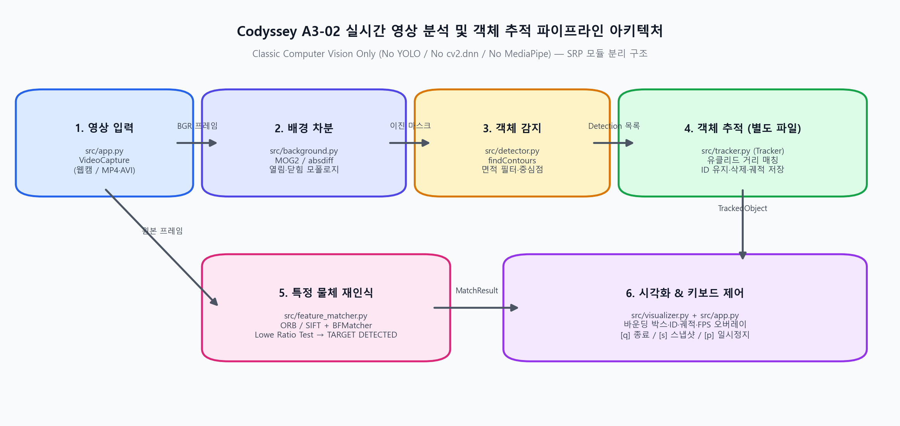
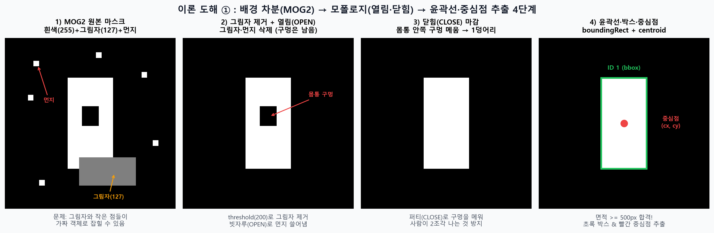
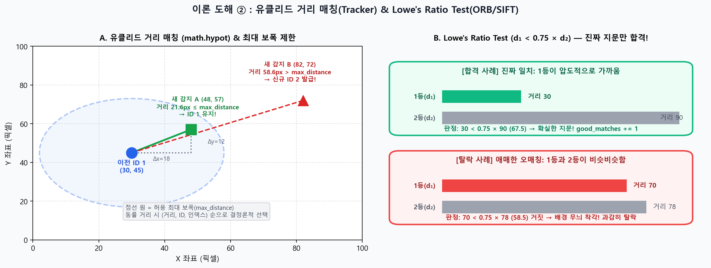
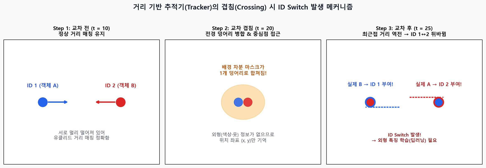
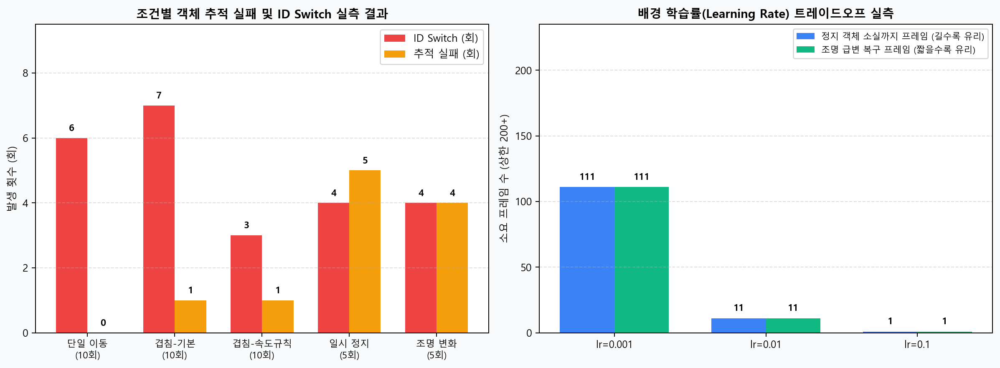
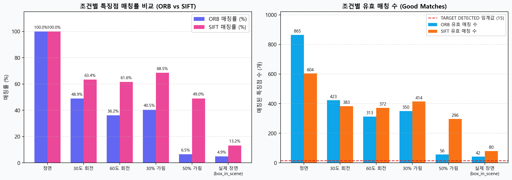

# 3개월 차 주니어를 위한 Codyssey A3-02 완전정복 가이드

> **"딥러닝(AI) 하나도 안 쓰고, CCTV 영상에서 움직이는 사람을 찾아 번호표를 붙이고 지나간 길까지 그려줄 수 있을까?"**  
> 이 문서는 코딩 입문 3개월 차 눈높이에서 **전문용어 하나도 그냥 넘어가지 않고**, **모든 그림·차트를 읽는 법부터 수식·규칙·순서·원리까지** 바닥부터 차근차근 설명하는 완전 해설서입니다.

---

## 1. 이 과제는 도대체 뭘 만든 건가요?

한 문장으로 요약하면 **"딥러닝(YOLO 같은 AI 모델) 없이 순수 수학 + OpenCV만으로 만든 실시간 CCTV 분석 앱과, 그 방식이 어디서 무너지는지 숫자로 증명한 실험 프로젝트"**입니다.

이 프로젝트는 크게 **3가지 기능**과 **1가지 한계 증명**으로 이루어집니다.
1. **움직임 감지 & 번호표 추적**: 고정된 CCTV 화면에서 움직이는 사람·물체만 골라내 네모 상자(`Bounding Box`), 고유 번호(`ID 1, ID 2...`), 지나온 이동 경로(`궤적`)를 실시간으로 그려줍니다.
2. **특정 물체 재인식 ("등록한 물건 찾기")**: 미리 등록해 둔 사진 1장(`box.png`)과 똑같은 물건이 화면에 나타나면 하단에 `"TARGET DETECTED (Target Found)"` 배너를 띄웁니다.
3. **실시간 제어**: 화면에 현재 처리 속도(`FPS`)를 띄우고, 키보드로 `q`(종료), `s`(현재 화면 스냅샷 저장), `p`(일시정지)를 조작합니다.
4. **고전 비전의 한계 증명**: 두 사람이 겹쳐 지나가거나, 잠깐 멈춰 서거나, 조명이 갑자기 밝아질 때 **"왜 딥러닝 없는 고전 방식은 실패하는가?"**를 실제 영상에서 숫자로 측정해 증명합니다.

---

## 2. 전체 구조는 어떻게 생겼나요? (파일 8개 역할 지도)

모든 코드를 `main.py` 하나에 몰아넣지 않고, **파일 하나당 딱 한 가지 일만 맡기는 구조(단일 책임 원칙, SRP)**로 `src/` 폴더 아래 8개 파일로 나누었습니다.



> **📖 이 그림 읽는 법**:
> - **각 네모 박스**는 `src/` 폴더 안의 파이썬 파일 1개(또는 담당 모듈)를 뜻합니다.
> - **화살표 위의 글자**는 앞 파일이 작업을 끝내고 다음 파일로 넘겨주는 데이터입니다.
> - 왼쪽 **1. 영상 입력**에서 사진 1장(`BGR 프레임`)이 들어오면 **위쪽 줄(2 → 3 → 4: 움직임 추적)**과 **아래쪽 줄(5: 등록 물건 찾기)** 두 갈래로 동시에 처리된 뒤, 마지막 **6. 시각화 & 키보드 제어**에서 한 화면으로 합쳐집니다.

| 파일명 | 쉬운 역할 비유 | 하는 일 (한 줄 요약) |
| :--- | :--- | :--- |
| `src/main.py` | **주문서 접수처** | 터미널 옵션(`--source`, `--learning-rate` 등)을 받아 프로그램 실행 |
| `src/config.py` | **코팅된 레시피표** | 설정값을 한곳에 모아두고 잘못된 숫자(음수 면적 등)를 실행 전 차단 |
| `src/app.py` | **현장 감독관** | 영상을 1프레임씩 읽어 5개 팀원에게 순서대로 일을 시키고 `q/s/p` 키 처리 |
| `src/background.py` | **배경 지우개 & 청소기** | 배경은 검정(0), 움직이는 물체만 흰색(255)으로 바꾸고 노이즈·구멍 정리 |
| `src/detector.py` | **네모 상자 측정관** | 흰 덩어리의 테두리를 따라 면적을 재고, 적당한 크기의 물체만 상자·중심점 추출 |
| `src/tracker.py` | **번호표 안내원 (별도 파일)** | 이전 프레임과 현재 프레임의 중심점 거리를 재어 같은 ID 유지 및 궤적 저장 |
| `src/feature_matcher.py` | **특징점 감식반** | 등록 사진(`box.png`)과 현재 화면의 특징점(ORB/SIFT)을 비교해 물체 발견 판정 |
| `src/visualizer.py` | **전담 화가** | 네모 상자, ID, 궤적 선, FPS, `TARGET DETECTED` 배너를 화면에 그려줌 |

---

## 3. 영상 1장이 화면에 나오기까지 어떤 과정을 거치나요? (프레임의 일생 6단계)

동영상은 **"1초에 10~30장씩 빠르게 넘기는 사진 묶음"**입니다. 프로그램은 `while True:` 루프를 돌며 사진(프레임) 1장이 들어올 때마다 아래 6단계를 순서대로 실행합니다.

1. **[입력]** `cap.read()`로 CCTV나 비디오 파일에서 컬러 사진 1장(`BGR` 픽셀 배열)을 읽습니다.
2. **[배경 분리]** `bg_subtractor.apply(frame)`가 평소 배경과 달라진 픽셀만 **흰색(숫자 255)**, 변화가 없는 배경은 **검은색(숫자 0)**으로 바꾼 **흑백 실루엣 지도(이진 마스크)**를 만듭니다.
   > **❓ Q. 변하는 곳은 움직이니 흰색, 움직임이 없는 곳은 검은색인 흑백 사진으로 바꾼다는 건가요?**  
   > **네, 정확히 맞습니다!** 컬러 사진 그대로는 "어디가 움직였는지" 컴퓨터가 계산하기 어렵기 때문에, **"움직임 있음 = 흰색(255), 움직임 없음(배경) = 검은색(0)"** 딱 2가지 색만 남긴 흑백 도장으로 먼저 변환합니다. (참고로 MOG2는 그림자를 회색 `127`로 표시해 주는데, `200`보다 작은 값은 전부 `0(검정)`으로 밀어버려서 그림자까지 지웁니다.)
3. **[객체 감지]** `detector.detect(fg_mask)`가 흑백 지도에서 흰 덩어리들의 바깥 테두리(윤곽선)를 찾고, 면적이 `500 ~ 100,000` 픽셀 사이인 진짜 물체만 골라 네모 상자(`bbox`)와 중심점(`centroid`)을 뽑습니다.
4. **[객체 추적]** `tracker.update(detections)`가 방금 전 프레임의 중심점들과 현재 프레임의 중심점들 사이의 직선 거리를 재어, 가장 가까운 짝끼리 같은 `ID`를 유지하고 이동 경로 목록에 새 중심점을 추가합니다.
   > **❓ Q. 그냥 아무거나 짝짓는 게 아니라 동일한 애들끼리 짝짓는 거 아닌가요? 프레임 단위라 가까운 것 기준으로 짝지어도 되는 건가요? 그래서 나중에 두 물체가 부딪히면 못 추적하는 건가요?**  
   > **정확히 핵심을 꿰뚫으셨습니다!**
   > - 우리 눈에는 "빨간 옷 입은 철수"가 보이지만, 이 고전 추적기는 **색깔도 얼굴도 전혀 모릅니다.** 오직 직전 프레임의 흰 덩어리 중심점 `(x, y)`들과 현재 프레임의 중심점 `(x, y)`들만 받습니다.
   > - 1초에 10~30장씩 찍히는 짧은 시간(프레임 단위) 안에서는 사람이 기껏해야 몇 픽셀밖에 못 움직이므로, **"직전 위치에서 제일 가까운 점이 같은 사람일 것이다"**라는 가정으로 짝을 짓는 것입니다.
   > - **바로 그 가정 때문에** 두 사람이 부딪히거나 겹쳐 지나가면 위치가 뒤섞이면서 누가 누구인지 구별할 방법이 없어져 **ID가 뒤바뀌는(ID Switch)** 한계가 발생합니다!
5. **[물체 재인식]** (등록 사진이 있으면) `feature_matcher.match(frame)`가 화면에서 ORB/SIFT 특징점을 뽑아 등록 사진(`box.png`)과 비교한 뒤, 확실히 일치하는 지점이 15군데 이상이면 `"TARGET DETECTED"` 신호를 켭니다.
   > **❓ Q. 'ORB/SIFT 지문을 뽑아'가 뭔가요? SVD 같은 걸로 특징을 뽑는 건가요? 물체는 3D라 360도 회전할 텐데 2D 사진 1장으로 가능한가요?**  
   > - SVD(행렬 분해)는 아니고, 사진 속에서 **밝기가 급격히 변하는 뾰족한 모서리·글자 끝·무늬 교차점(특징점, Keypoint)** 수백 개를 찾은 뒤, 각 점 주변의 밝기 패턴을 **숫자 배열(벡터)**로 요약해 비교합니다. 이해하기 쉽게 "지문"이라고 비유한 것입니다. (구체적인 계산 원리는 아래 **4장 이론 ④**에서 자세히 설명합니다.)
   > - **3D 회전 질문도 정확합니다 — 360도 돌아가면 못 찾습니다!** 평면 회전(2D로 시계처럼 돌리기)이나 약간의 크기 변화는 알고리즘이 보정해서 어느 정도 찾지만, **3D 회전(상자의 뒷면이 보임)**이나 심한 가림이 생기면 2D 사진 1장에 찍혀 있던 무늬 자체가 화면에서 사라지므로 인식이 무너집니다. 이 한계를 직접 확인하는 것이 이 과제의 실험 목표 중 하나입니다.
6. **[그리기 & 제어]** `visualizer.draw(...)`가 네모 상자·ID·궤적 선·FPS·배너를 원본 컬러 사진 위에 겹쳐 그려 모니터에 띄우고, 사용자가 `q`/`s`/`p` 키를 눌렀는지 확인합니다.

---

## 4. 핵심 이론 4가지 & 핵심 코드 완전 해부

---

### 이론 ①: 배경 차분(MOG2) + 모폴로지(열림·닫힘) + 윤곽선 검출



> **📖 이 그림 읽는 법 (왼쪽 → 오른쪽 4단계 변화)**:
> - **1) MOG2 원본 마스크**: 배경 차분 직후의 흑백 결과입니다. 가운데 큰 흰 네모가 사람이고, 아래 회색(`127`)이 그림자, 주변의 작은 흰 점들이 카메라 노이즈(먼지), 사람 몸통 한가운데의 검은 사각형이 옷 색깔 때문에 뚫린 구멍입니다.
> - **2) 그림자 제거 + 열림(OPEN)**: 회색 그림자(`127`)와 주변의 작은 흰 먼지들이 전부 사라졌습니다. 다만 몸통 한가운데 검은 구멍은 아직 남아 있습니다.
> - **3) 닫힘(CLOSE) 마감**: 몸통 안쪽의 검은 구멍까지 하얗게 메워져 깔끔한 1개의 흰 덩어리가 완성되었습니다.
> - **4) 윤곽선·박스·중심점**: 완성된 흰 덩어리 테두리에 초록색 네모 상자(`bbox`)를 씌우고 정중앙에 빨간 점(`centroid`)을 찍어 추적기로 넘길 준비를 마칩니다.

#### 🧠 원리 상세 설명
1. **배경 차분 (MOG2)**:
   - 벽·바닥처럼 가만히 있는 픽셀은 시간이 지나도 색이 거의 비슷합니다. **MOG2(Mixture of Gaussians 2)**는 화면의 모든 픽셀마다 *"평소에 주로 어떤 색(정규분포)이 나왔는지"*를 기억해 둡니다.
   - 새 프레임에서 평소 색깔과 크게 다른 픽셀은 **흰색(255)**, 살짝 어두워진 곳은 **그림자(127)**, 평소와 같은 곳은 **검정(0)**으로 칠합니다. 이후 `cv2.threshold(..., 200, 255, ...)`로 `200` 이하(그림자 127 포함)를 전부 `0`으로 지웁니다.
2. **모폴로지 연산 (`MORPH_OPEN` 열림 & `MORPH_CLOSE` 닫힘)**:
   > **❓ Q. 이전에 morph는 외곽에 정해진 픽셀만큼 주변을 깎거나 칠하던데, 가령 `4×4` 사각형 먼지가 있고 열림이 2픽셀이면 `4×4`가 아예 없어져서 다시 키울 때 키울 게 없는 식인가요?**  
   > **100% 정확하게 이해하셨습니다!** 모폴로지는 지정한 도장 크기(커널, 본 코드에서는 `5×5` 픽셀 ➔ 반지름 약 2픽셀)만큼 외곽을 깎거나(**침식, Erosion**) 주변에 덧칠하는(**팽창, Dilation**) 연산입니다.
   > - **열림(`MORPH_OPEN` = 침식 후 팽창)**: `4×4` 크기 작은 먼지의 상하좌우 테두리를 2픽셀씩 깎으면(`4 - 2×2 = 0`) **먼지 자체가 화면에서 완전히 증발**합니다. 그다음 2픽셀씩 다시 키워도(`팽창`) 이미 사라져 키울 픽셀이 없으므로 먼지는 영원히 사라집니다! 반면 `30×60` 크기 사람 몸통은 `26×56`으로 살짝 줄었다가 다시 `30×60`으로 원래 크기를 회복합니다.
   > - **닫힘(`MORPH_CLOSE` = 팽창 후 침식)**: 정확히 반대입니다. 먼저 2픽셀씩 덧칠(`팽창`)하면 사람 몸통 안쪽의 `4×4` 검은 구멍이 사방에서 밀려온 흰색에 완전히 덮여 메워집니다. 그다음 2픽셀씩 깎아내도(`침식`) 이미 꽉 찬 구멍은 다시 뚫리지 않습니다!
3. **윤곽선 추출 & 면적 필터링**:
   > **❓ Q. 위 3장에서 본 '면적이 `500 ~ 100,000` 픽셀 사이인 진짜 물체만 골라 네모 상자(`bbox`)와 중심점(`centroid`)을 뽑습니다'와 동일한 건가요?**  
   > **네, 완전히 같은 단계입니다!** 3장에서 전체 흐름을 요약했던 `[3. 객체 감지]`를 실제 OpenCV 함수(`findContours`, `contourArea`, `boundingRect`)로 구현한 부분입니다. `500` 미만은 남은 미세 노이즈로 버리고, `100,000` 초과는 조명 급변으로 화면 전체가 하얗게 번진 오검출로 버립니다.

#### 💻 핵심 코드 (`src/background.py` & `src/detector.py`)
```python
# [src/background.py] 1) MOG2 적용 → 2) 그림자(127) 제거 → 3) 열림(먼지 제거) → 4) 닫힘(구멍 메움)
raw_mask = self._mog2.apply(frame, learningRate=self.learning_rate)
_, binary_mask = cv2.threshold(raw_mask, 200, 255, cv2.THRESH_BINARY)
opened = cv2.morphologyEx(binary_mask, cv2.MORPH_OPEN, self.kernel)
cleaned = cv2.morphologyEx(opened, cv2.MORPH_CLOSE, self.kernel)

# [src/detector.py] 최외곽선 추출 후 면적 필터링(500~100,000px) 및 중심점 계산
contours, _ = cv2.findContours(fg_mask, cv2.RETR_EXTERNAL, cv2.CHAIN_APPROX_SIMPLE)
for contour in contours:
    area = float(cv2.contourArea(contour))
    if area < self.min_area or area > self.max_area:
        continue
    x, y, w, h = cv2.boundingRect(contour)
    cx, cy = int(x + w / 2), int(y + h / 2)
```

---

### 이론 ②: 유클리드 거리 기반 최근접 매칭 & `deque` 궤적 관리



> **📖 이 그림 읽는 법 (이 그림은 두 개의 주제가 좌·우로 나뉘어 있습니다)**:
> - **왼쪽 그림 A (이론 ② — 객체 추적의 거리 매칭)**:
>   - **X축 / Y축**: 화면 상의 가로·세로 픽셀 좌표입니다.
>   - **파란 원 `(30, 45)`**: 직전 프레임에 있던 `ID 1`의 중심점입니다.
>   - **파란 점선 원**: `ID 1`을 중심으로 반지름 `max_distance`만큼 그린 **"한 프레임에 이동 가능한 최대 보폭 범위"**입니다.
>   - **초록 사각형 A `(48, 57)`**: 현재 프레임에서 발견된 새 점입니다. 가로 차이 `Δx=18`, 세로 차이 `Δy=12`를 피타고라스 정리(`math.hypot(18, 12)`)로 재면 직선 거리 `21.6px`이고, 점선 원 안쪽이므로 **`ID 1`을 그대로 유지**합니다.
>   - **빨간 삼각형 B `(82, 72)`**: 거리가 `58.6px`로 점선 원 바깥에 있으므로 같은 사람일 수 없다고 보고 **신규 `ID 2`를 발급**합니다.
> - **오른쪽 그림 B (이론 ④ — Lowe's Ratio Test 미리보기)**:
>   - 등록 사진과 현재 화면의 특징점을 비교할 때 **"진짜 일치(초록 박스) vs 헷갈리는 오매칭(빨간 박스)"**을 가르는 심사 규칙입니다. 자세한 원리와 숫자 계산법은 아래 **이론 ④**에서 단계별로 설명합니다!

#### 🧠 원리 상세 설명
> **❓ Q. 내가 이해한 게 맞나요? 프레임 단위로 직전과 변한 것들을 조사해 흰색/검은색으로 나누고, 흰색 물체들끼리 직전 프레임과 현재 프레임의 거리를 구해서 그냥 가까운 순으로 같은 타겟이라고 인식한다는 건가요?**  
> **네, 100% 정확하게 이해하셨습니다!** 이 추적기(`src/tracker.py`)의 동작 전체가 바로 그것입니다:
> 1. 배경과 달라진 영역을 흰색(255), 나머지를 검은색(0)으로 나눈다.
> 2. 흰 덩어리들의 중심점 `(cx, cy)`를 구한다.
> 3. 직전 프레임 중심점들과 현재 프레임 중심점들 사이의 **유클리드 직선 거리**($\sqrt{\Delta x^2 + \Delta y^2}$, `math.hypot`)를 모두 계산한 뒤, **가장 짧은 거리 쌍부터 1:1로 짝지어 같은 ID**를 부여한다.
> 4. 단, 제일 가까운 짝이라도 거리가 `max_distance`(80px)를 넘으면 매칭을 거절하고 **새 ID**를 발급한다.
> 5. 만약 두 객체의 거리가 똑같이 비기는(동률) 경우를 대비해 `(거리, object_id, det_idx)` 순으로 정렬하여 항상 작은 ID가 먼저 선택되도록(결정론적 타이 브레이킹) 처리한다.

- **소멸 카운터(`max_disappeared = 15`)**: 객체가 기둥 뒤에 잠깐 숨어 1~2프레임 안 보여도 바로 지우지 않고 `disappeared`를 1씩 올리며 **15프레임까지 기다려준 뒤**, 그 이상 안 돌아오면 ID를 삭제합니다.
- **궤적 저장(`collections.deque(maxlen=50)`)**:
  > **❓ Q. '최근 50걸음만 저장한다'가 무슨 말인가요? 5프레임의 이동경로를 저장한다는 건가요?**  
  > **5프레임이 아니라 최근 50프레임(50개의 중심점 좌표)**입니다! 프레임 1장이 지날 때마다 객체의 중심점 `(cx, cy)`가 1개씩 기록되므로, `maxlen=50`은 **최근 50프레임 동안의 위치 50개**를 이어 이동 선(꼬리)으로 그린다는 뜻입니다. (10 FPS 영상이라면 최근 5초 분량의 이동 경로입니다.) 51번째 프레임 좌표가 들어오면 맨 처음 1번째 좌표는 자동으로 밀려나 삭제되므로, 영상이 10시간 돌아가도 메모리가 넘치지 않습니다.

#### 💻 핵심 코드 (`src/tracker.py`)
```python
# 모든 (기존 객체, 새 감지) 쌍의 유클리드 거리 계산 및 결정론적 정렬
pairs = []
for obj_id in sorted(self.objects.keys()):
    ref_pt = self._reference_point(self.objects[obj_id])
    for det_idx, det in enumerate(detections):
        dist = math.hypot(ref_pt[0] - det.centroid[0], ref_pt[1] - det.centroid[1])
        pairs.append((dist, obj_id, det_idx))

pairs.sort(key=lambda item: (item[0], item[1], item[2]))

# 가장 가까운 쌍부터 1:1 매칭 (최대 보폭 초과 시 조기 종료)
for dist, obj_id, det_idx in pairs:
    if dist > self.max_distance:
        break
    if obj_id in used_object_ids or det_idx in used_det_indices:
        continue
    # 속도(vx, vy), 중심점, 궤적(deque) 갱신
```

---

### 이론 ③: 겹침(ID Switch), 속도 예측 규칙, 그리고 배경 학습률의 딜레마

먼저 앞으로 나올 **3가지 핵심 용어**부터 정확히 짚고 그림을 보겠습니다.
- **겹침 (Crossing / Overlap)**: 두 사람(객체)이 화면에서 서로 스쳐 지나가며 하나의 덩어리처럼 겹치는 상황입니다.
- **ID Switch (번호표 뒤바뀜)**: 겹침 전에는 A가 `ID 1`, B가 `ID 2`였는데, 겹친 뒤 갈라질 때 추적기가 헷갈려서 A에게 `ID 2`, B에게 `ID 1`을 붙여버리는 오류입니다. (본 과제 기준: 5프레임 이상 잘못된 ID가 유지되면 1회로 카운트)
- **속도 예측 규칙 (`use_velocity_prediction=True`)**: 기본 추적기는 "직전에 서 있던 자리"와 거리를 재지만, 여기에 **"방금 오른쪽으로 +10px 움직였으니 이번에도 오른쪽으로 +10px 더 간 예상 자리와 거리를 재자!"**라는 관성 규칙을 추가해 본 개선 시도입니다.

#### 1) 겹침 시 ID Switch가 발생하는 과정


> **📖 이 그림 읽는 법 (왼쪽 → 오른쪽 시간 순서)**:
> - **Step 1 (교차 전, t=10)**: 왼쪽의 **파란 공(`ID 1`, 객체 A)**은 오른쪽으로, 오른쪽의 **빨간 공(`ID 2`, 객체 B)**은 왼쪽으로 걸어옵니다. 둘이 멀어서 거리 매칭이 100% 정확합니다.
> - **Step 2 (교차 겹침, t=20)**: 두 사람이 한가운데서 스쳐 지나가며 **주황색 원처럼 배경 차분 마스크가 1개 덩어리로 합쳐집니다.** 추적기는 옷 색깔(파랑/빨강)을 모르고 좌표만 기억합니다.
> - **Step 3 (교차 후, t=25)**: 실제 A(파란 속)는 오른쪽으로, 실제 B(빨간 속)는 왼쪽으로 빠져나왔습니다. 하지만 겹치기 직전 `ID 1`의 기억 위치(왼쪽)와 더 가까운 것은 왼쪽으로 나온 **실제 B**가 되어버립니다! 결국 테두리 색(부여된 ID)과 속 색(실제 사람)이 반대로 뒤바뀌는 **ID Switch**가 일어납니다.

#### 2) 배경 모델링에서의 '학습률(Learning Rate)'이란 무엇인가요?
> **❓ Q. 학습률 개념이 여기서 갑자기 왜 등장하나요? 최적화(딥러닝)의 학습률과 다른 건가요? 직전 배경과 현재 배경이 같으면 배경이라 치부하는 것 아닌가요? 학습률이 높으면 어떤 일이 일어나나요?**  
> **정말 중요한 질문입니다!** 딥러닝 경사하강법의 학습률과 이름은 같지만, 배경 차분(MOG2)에서의 학습률(`learning_rate`, 보통 $\alpha$로 표기)은 **완전히 다른 역할**을 합니다.
> - CCTV는 시간이 지나면 해가 지거나 전등이 켜지면서 **"원래 배경" 자체도 조금씩 변합니다.** 그래서 첫 프레임만 영원히 배경으로 고정해 두면 안 되고, 매 프레임마다 배경 기억을 조금씩 업데이트해야 합니다.
> - 이때 배경 기억을 갱신하는 공식이 바로 이것입니다:
>   $$\text{새 배경 기억} = (1 - \alpha) \times \text{기존 배경 기억} + \alpha \times \text{현재 프레임}$$
> - 여기서 $\alpha$가 바로 **배경 학습률(`learning_rate`)**입니다! 즉, **"현재 화면을 '원래 배경' 기억에 몇 % 비율로 섞어서 덮어쓸 것인가?"**를 결정하는 속도 다이얼입니다.
>   - **학습률이 낮을 때 (`0.001` = 0.1%씩 섞음)**: 배경 기억이 아주 느리게 바뀝니다. 사람이 잠깐 멈춰 서 있어도 111프레임 동안은 여전히 "배경이 아닌 사람"으로 잘 알아봅니다. **단점**: 방 불이 켜져서 화면이 확 밝아졌을 때 "아, 밝아진 방이 새 배경이구나" 하고 적응하는 데도 111프레임이나 걸려 그 시간 동안 화면 전체가 고장 납니다.
>   - **학습률이 높을 때 (`0.1` = 10%씩 확확 섞음)**: 새 장면을 순식간에 배경으로 외워버립니다. 불이 켜져도 **1프레임 만에** 새 배경으로 적응합니다. **단점**: 천천히 걷는 사람마저 **1프레임 만에 "어? 얘도 원래 배경인가 보다" 하고 배경 기억에 흡수시켜 화면에서 지워버립니다!**

#### 3) 정량 실험 차트 해독하기


> **📖 이 차트 읽는 법 (왼쪽 그래프 + 오른쪽 그래프)**:
> - **왼쪽 그래프 — 조건별 추적 오류 실측 결과**:
>   - **X축**: 실험한 5가지 상황 (`단일 이동 10회`, `겹침-기본 10회`, `겹침-속도규칙 10회`, `일시 정지 5회`, `조명 변화 5회`).
>   - **Y축**: 오류가 발생한 횟수(회). **빨간 막대 = ID Switch 횟수**, **주황 막대 = 추적 실패(10프레임 이상 놓침) 횟수**.
>   - **어떻게 읽나요?**:
>     - `겹침-기본`에서는 10번 교차 중 **7번(70%)**이나 ID Switch가 터졌습니다.
>     - 여기에 속도 예측 규칙을 넣은 `겹침-속도규칙`에서는 **7번 → 3번(30%)**으로 절반 이하로 줄었습니다! 하지만 두 사람이 마주친 뒤 **방향을 꺾는 3건에서는 관성 예측이 오히려 반대편 사람을 가리켜 100% 또 실패**했습니다.
>     - `일시 정지`(5회 중 5회 실패)와 `조명 변화`(5회 중 4회 실패)에서는 배경 모델 자체가 무너져 추적이 대거 실패했습니다.
> - **오른쪽 그래프 — 배경 학습률 3종(`0.001`, `0.01`, `0.1`) 트레이드오프**:
>   - **X축**: MOG2에 설정한 3가지 학습률 값.
>   - **Y축**: 걸린 프레임 수. **파란 막대 = 정지한 객체가 배경에 흡수되어 사라지기까지 버틴 시간(길수록 좋음)**, **초록 막대 = 조명 급변(+60) 후 화면이 정상으로 복구되는 데 걸린 시간(짧을수록 좋음)**.
>   - **어떻게 읽나요?**: `lr=0.001`은 파란 막대가 `111`로 오래 버티지만 초록 막대도 `111`로 복구가 너무 느립니다. `lr=0.1`은 초록 막대가 `1`로 복구가 빠르지만 파란 막대도 `1`이라 서 있는(심지어 걷는) 사람까지 1프레임 만에 사라져 버립니다. **파란 막대는 길고 초록 막대는 짧았으면 좋겠는데, 둘이 항상 똑같이 움직여 동시에 잡을 수 없다는 한계**를 보여주는 차트입니다!

---

### 이론 ④: ORB & SIFT의 원리와 Lowe's Ratio Test

#### 1) ORB와 SIFT는 도대체 무엇이고 어떻게 작동하나요?
사진 전체 픽셀을 1:1로 비교하면 물체가 1cm만 옆으로 가거나 살짝 기울어져도 픽셀 숫자가 다 틀어집니다. 그래서 **"사진에서 가장 눈에 띄는 모서리·글자 끝 같은 지점(특징점, Keypoint) 수백 개만 골라, 각 지점 주변의 밝기 모양을 숫자 배열(기술자, Descriptor)로 바꿔 비교하자"**는 것이 특징점 매칭입니다.

| 구분 | **SIFT** (정밀하지만 느림) | **ORB** (초고속이지만 변형에 약함) |
| :--- | :--- | :--- |
| **1단계: 점 찾기** | 이미지를 여러 크기로 흐리게 만들어 크기가 바뀌어도 변하지 않는 코너·경계점을 정밀하게 탐색 | FAST 알고리즘으로 주변 픽셀보다 확 밝거나 어두운 모서리를 초고속으로 탐색 |
| **2단계: 숫자 지문 만들기** | 점 주변 영역에서 밝기가 어느 방향으로 진해지는지(**기울기 화살표 분포 = 히스토그램**)를 세어 **128개의 실수 숫자 배열**로 요약 | 점 주변의 픽셀 쌍 256개를 골라 **"A점이 B점보다 밝으면 `1`, 어두우면 `0`"** 식으로 **256개의 0과 1(이진 비트)** 문자열로 요약 |
| **3단계: 두 지문 비교 방식** | 128개 실수 숫자 배열 사이의 **L2 거리(128차원 피타고라스 직선 거리)** 계산 ➔ 계산량 많음 | 두 0/1 문자열에서 **서로 다른 자리 개수만 셈(해밍 거리, 예: `1010` vs `1110` = 거리 1)** ➔ CPU가 비트 연산으로 순식간에 계산 |
| **장단점** | 회전·크기 변화·가림에 훨씬 강함 | 매우 빠르지만 단순 밝기 대소 비교라 회전·가림에 쉽게 깨짐 |

#### 2) Lowe's Ratio Test — 매칭 규칙·순서·원칙 완전 해부!
> **❓ Q. '1등 거리가 70, 2등 거리가 78이면 탈락, 1등 30, 2등 90이면 `30 < 0.75 × 90`이라 합격' 이게 무슨 소리인가요? 0.75는 어디서 나온 거고 1등이 이긴다는 건가요, 2등이 이긴다는 건가요?**

먼저 가장 헷갈리기 쉬운 **단어 1개**부터 바로잡겠습니다!
- 여기서 말하는 **"거리(distance)"는 화면 위 위치 거리가 아닙니다!** **"두 지문(숫자 배열)이 얼마나 다르게 생겼는가"를 나타내는 불일치 점수(오차)**입니다.
  - **거리 = `0`**: 두 지문이 100% 똑같이 생겼다 (완벽 일치!)
  - **거리 = `100`**: 전혀 딴판으로 생겼다.

이제 실제 코드(`knnMatch(k=2)`)가 **어떤 순서와 원칙**으로 매칭하는지 4단계로 보겠습니다.

1. **[1단계 — 등록 지문 1개 선택]**: 등록 사진(`box.png`)에서 뽑은 특징점 865개 중 1개(예: 상자 로고의 'B' 모서리 지문)를 집어 듭니다.
2. **[2단계 — CCTV에서 1등·2등 후보 뽑기]**: 현재 CCTV 화면에 있는 특징점 1,000개와 전부 불일치 점수(거리)를 계산한 뒤, **가장 적게 다른(제일 닮은) 1등 후보(`m`, 오차 $d_1$)**와 **두 번째로 닮은 2등 후보(`n`, 오차 $d_2$)**를 뽑습니다. *(1등이 더 닮았으니 항상 $d_1 \le d_2$입니다.)*
3. **[3단계 — 왜 1등만 바로 믿지 않고 2등까지 비교할까?]**:
   - 만약 CCTV 화면에 우리가 찾는 상자가 **아예 없어도**, 컴퓨터는 1,000개 중 억지로라도 제일 덜 다른 점 1개를 1등으로 뽑아옵니다!
   - 이때 화면의 벽지나 바닥처럼 비슷한 무늬가 많으면 **1등 오차도 70, 2등 오차도 78**처럼 둘이 도토리 키재기로 비슷하게 나옵니다. 즉 **"1등이 진짜 그 상자 모서리인지, 그냥 흔한 벽지 무늬인지 헷갈린다"**는 신호입니다!
   - 반대로 진짜 상자가 화면에 있다면, 상자 위의 진짜 모서리(1등)만 오차가 확 작고(`30`), 나머지 배경의 아무 점(2등)은 전혀 다르므로 오차가 확 큽니다(`90`).
4. **[4단계 — 최종 합격 심사 공식 (`d1 < 0.75 × d2`)]**:
   - **2등이 이기는 게 아닙니다!** **무조건 1등 후보(`m`)를 진짜 일치로 인정할지, 아니면 헷갈리니까 아예 버릴지를 결정하는 합격 기준**입니다.
   - `0.75`는 SIFT 논문 저자(David Lowe)가 수많은 실험으로 정한 **압도적 격차 기준(75%)**입니다: *"1등의 오차($d_1$)가 2등 오차($d_2$)의 75%보다도 작을 만큼 **1등이 독보적으로 닮았을 때만** 1등을 진짜 일치(`good_matches`)로 합격시킨다!"*
   - **✅ 합격 사례 (이론 도해 ② 오른쪽 위 초록 박스)**: 1등 오차 `30`, 2등 오차 `90` ➔ 2등의 75%는 `0.75 × 90 = 67.5`. 1등 오차(`30`)가 `67.5`보다 훨씬 작으므로(`30 < 67.5` 참!) ➔ **"1등은 독보적인 진짜다! 합격 (`good_matches += 1`)"**.
   - **❌ 탈락 사례 (이론 도해 ② 오른쪽 아래 빨간 박스)**: 1등 오차 `70`, 2등 오차 `78` ➔ 2등의 75%는 `0.75 × 78 = 58.5`. 1등 오차(`70`)가 `58.5`보다 크므로(`70 < 58.5` 거짓!) ➔ **"1등과 2등이 비슷해서 못 믿겠다! 1등도 과감히 버림"**.
5. **[5단계 — 최종 물체 발견 판정]**: 등록 사진의 모든 특징점에 대해 1~4단계를 돌린 뒤, 최종 합격한 지문 수(`good_matches`)가 **15개 이상**이면 화면에 `"TARGET DETECTED"`를 띄웁니다!

#### 3) ORB vs SIFT 벤치마크 차트 해독하기


> **📖 이 차트 읽는 법**:
> - **X축 (공통)**: 등록 사진(`box.png`)에 가한 6가지 테스트 조건 (`정면`, `30도 회전`, `60도 회전`, `30% 가림`, `50% 가림`, `실제 배경이 섞인 box_in_scene.png`).
> - **왼쪽 그래프 (Y축 = 매칭률 %)**: 등록 사진 특징점 중 몇 %가 Lowe's Ratio Test를 통과했는지 보여줍니다. 보라색=ORB, 분홍색=SIFT.
>   - 정면은 둘 다 `100%`이지만, `50% 가림`에서 ORB는 **`6.47%`**로 급락하고, 실제 장면(`box_in_scene`)에서는 ORB **`4.86%`**, SIFT **`13.25%`**까지 떨어집니다.
> - **오른쪽 그래프 (Y축 = 합격한 매칭 개수)**: 하늘색=ORB, 주황색=SIFT, **빨간 점선 = `"TARGET DETECTED"` 판정 기준선(15개)**.
>   - `box_in_scene`에서 ORB는 `42개`, SIFT는 `80개`로 가까스로 15개 선을 넘어 검출에 성공했지만, 각도가 더 틀어지거나 조명이 나빠지면 쉽게 15개 아래로 떨어져 실패하게 됩니다.

#### 💻 핵심 코드 (`src/feature_matcher.py`)
```python
# 등록 지문(target_des)마다 CCTV 지문(frame_des)에서 가장 닮은 1등(m), 2등(n) 추출
knn_matches = self._matcher.knnMatch(self._target_des, frame_des, k=2)
good_count = 0
for pair in knn_matches:
    if len(pair) == 2:
        m, n = pair
        # 1등 오차가 2등 오차의 75% 미만으로 독보적일 때만 1등을 합격시킴
        if m.distance < self.ratio_thresh * n.distance:
            good_count += 1

detected = good_count >= self.min_match_count  # 15개 이상이면 TARGET DETECTED!
```

---

## 5. 3개월 차가 꼭 챙겨야 할 실무 방어 코드 3가지

1. **Windows 한글 경로 이미지 깨짐 방어 (`src/feature_matcher.py`, `src/visualizer.py`)**:
   - OpenCV의 `cv2.imread("C:/Users/안재현/box.png")`는 Windows에서 경로에 한글이 있으면 에러도 없이 `None`을 반환합니다.
   - 해결책: `np.fromfile()`로 바이트를 먼저 읽고 `cv2.imdecode()`로 복원합니다. 저장할 때도 `cv2.imencode()` + `Path.write_bytes()`를 사용합니다.
2. **특징점이 2개 미만인 어두운 프레임 크래시 방어 (`src/feature_matcher.py`)**:
   - 화면이 까맣게 꺼져 특징점이 0~1개만 나오면 `knnMatch(k=2)`가 2등을 못 뽑아 프로그램이 바로 죽습니다.
   - 해결책: `if frame_des is None or frame_count < 2: return MatchResult(detected=False, ...)`로 안전하게 빠져나옵니다.
3. **`try-finally` 카메라·파일 리소스 안전 해제 (`src/app.py`)**:
   - 실행 도중 에러가 나거나 강제 종료해도 `finally:` 블록에서 `cap.release()`와 `cv2.destroyAllWindows()`를 무조건 실행해 웹캠 잠김이나 녹화 파일 손상을 막습니다.

---

## 6. 최종 결론: 그래서 딥러닝이 왜 필요한가요?

1. **겹침(ID Switch) 해결**: 좌표·속도만 보지 않고 딥러닝(DeepSORT/Re-ID)으로 **옷 색깔·생김새(외형)**를 기억하면 두 사람이 교차 후 방향을 틀어도 원래 ID를 지킬 수 있습니다.
2. **회전·가림(특징점 한계) 해결**: 2D 사진 1장의 코너 패턴(ORB/SIFT) 대신 다양한 각도·가림 데이터로 학습한 신경망(CNN/ViT)은 3D로 돌아가거나 절반 가려져도 **물체의 전체 구조**로 알아봅니다.
3. **정지·조명 급변(배경 차분 한계) 해결**: "픽셀이 변했는가?"가 아니라 딥러닝 탐지기(YOLO/RT-DETR)가 **"이 영역이 사람인가?"**를 직접 판별하므로 사람이 멈춰 서 있거나 전등이 켜져도 추적이 무너지지 않습니다.

---

> **📌 이어서 보기**:
> - 코드 한 줄 한 줄을 단어 단위로 쪼개서 공부하기 ➔ [핵심_코드_스터디.md](핵심_코드_스터디.md)
> - 전체 정량 실험 표와 CCTV 설치·운영 가이드 보기 ➔ [../REPORT.md](../REPORT.md)
> - 원본 과제 요구사항 1:1 체크리스트 보기 ➔ [../스터디.md](../스터디.md)
