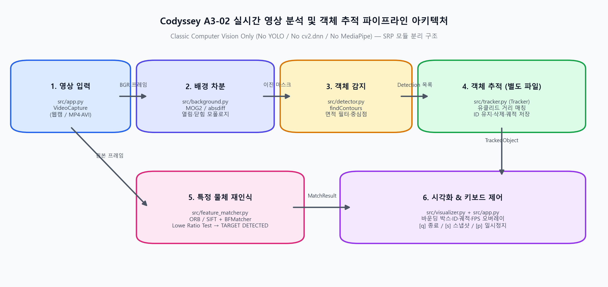
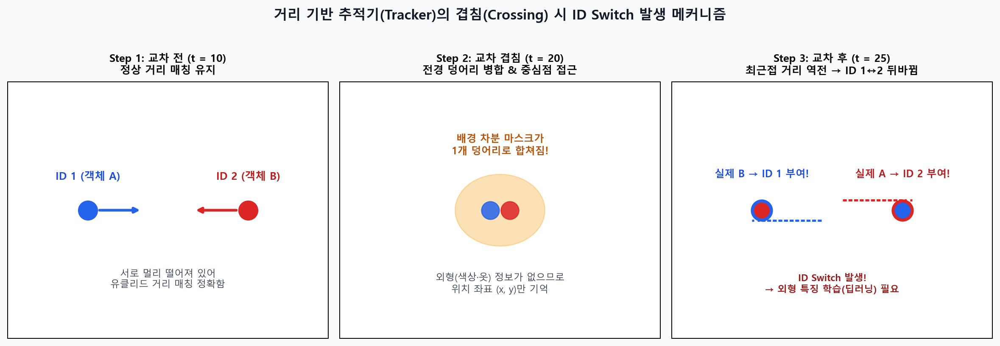
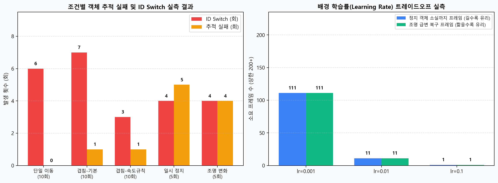
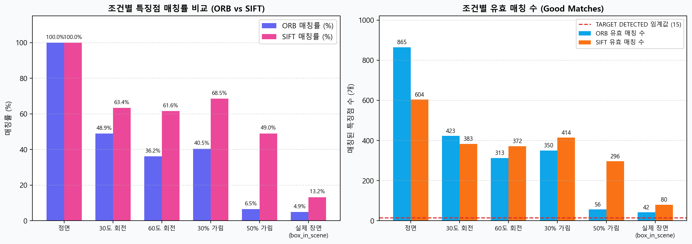

# 스터디.md — Codyssey A3-02 요구사항 1:1 검증 · 주니어 비유 · 아키텍처 다이어그램 해설

> 본 문서는 원본 과제 파일(`코디세이 a3-02.md`)의 전문을 100% 수록하고, 모든 요구사항이 코드와 실험으로 충족되었음을 1:1로 대조 검증하며, 코딩 3개월 차 주니어 개발자의 눈높이에서 전체 아키텍처와 동작 원리를 쉽게 설명하는 학습 문서입니다.

---

## 1. 원본 과제 요구사항 전문 (100% 원문 수록)

<details open>
<summary><strong>원본 과제 파일: 코디세이 a3-02.md 전문 펼치기/접기</strong></summary>

### **1. 미션 소개**

동영상은 시간 축을 가진 이미지의 연속입니다. 정지된 사진과 달리, 프레임 간의 변화를 분석하면 "무엇이 움직이는지", "어디로 이동하는지"를 파악할 수 있습니다. CCTV 보안 시스템, 자율주행 차량의 보행자 감지, 스포츠 경기 분석 등 실시간 영상 처리는 다양한 산업에서 핵심 기술로 활용됩니다. 특히 Mobility(보행자/차량 추적), Smart Factory(라인 모니터링), Robotics(작업자/부품 추적), Healthcare(재활 동작 모니터링), E-Commerce(매장 동선/물류 추적) 등 다양한 도메인에서 이 역량이 활용됩니다. 이 미션에서는 OpenCV를 활용해 영상 속 움직이는 객체를 감지하고, 고유 ID를 부여하여 추적하는 시스템을 직접 구현합니다. 배경 차분으로 움직임을 감지하고, 특징점 매칭으로 특정 물체를 재인식하는 과정을 경험합니다. 각 객체의 이동 경로를 시각화하고, 추적이 유지되거나 실패하는 순간을 직접 관찰합니다. 또한, 두 사람이 겨춰 지나갈 때 ID가 뒤바뀌는 현상, 조명이 변할 때 추적이 무너지는 현상을 정량적으로 분석합니다. 이를 통해 "위치 정보만으로는 객체를 구분할 수 없다"는 한계를 체감하고, 객체의 외형을 학습하는 딥러닝 기반 접근이 왜 필요한지 스스로 이해하게 됩니다.

### **2. 최종 결과물**

다음 기능이 정상 동작하는 Python 비디오 분석 애플리케이션 1개와 한계 분석 보고서 1개를 완성한다. 최종 산출물은 GitHub 리포지토리로 제출한다.

1. 실시간 영상 분석 애플리케이션
   * 웹캠 스트림 또는 비디오 파일을 입력받아 프레임 단위로 분석한다.
   * 화면에 분석 결과(바운딩 박스, 궤적, ID)가 오버레이되어 출력된다.
   * FPS가 화면에 표시되고, 키보드로 제어(종료, 스냅샷, 일시정지)할 수 있다.
2. 모션 감지 및 객체 추적
   * 화면 내에서 움직이는 물체를 배경과 분리하여 감지한다.
   * 감지된 객체에 고유 ID를 부여하고, 물체가 이동해도 ID를 유지하며 추적한다.
   * 물체의 이동 경로를 선으로 시각화한다.
3. 특정 물체 재인식
   * 미리 등록된 이미지(특정 물체)가 영상에 등장하면 "Target Found"를 표시한다.
   * 특징점 매칭 기반으로 동작한다.
4. 분석 보고서
   * 추적 성능을 정량적으로 측정한 결과가 포함된다.
   * 알고리즘이 실패하는 조건(겹침, 가림, 조명 변화)을 분석한다.
   * "고전적 컴퓨터 비전의 한계"와 "딥러닝이 필요한 이유"에 대한 결론이 포함된다.
   * **분석 보고서 요구사항**:
     1. 추적 성능 측정 결과 (단일 객체 이동 10회 / 두 객체 겹침 10회 / 객체 일시 정지 5회 / 조명 변화 5회 — ID Switch: 겹침 이후 5프레임 이상 다른 ID 유지, 추적 실패: 10프레임 이상 미검출 또는 ID 미부여, 50% 이상 가림 구간은 추적 실패 제외 후 비고 기록)
     2. 특징점 매칭 성능 측정 (정면 / 30도 회전 / 60도 회전 / 30% 가림 / 50% 가림 — 추출 특징점 수 / 매칭 특징점 수 / 매칭률)
     3. 배경 모델링의 한계 (배경 학습률에 따른 동작 차이, 느린 변화 vs 빠른 변화 트레이드오프, 조명 변화 문제)
     4. 거리 기반 추적의 본질적 한계 (겹침 시 ID Switch 원인, 규칙 추가 시도와 결과, "위치만으로는 객체를 구분할 수 없다" 결론)
     5. Hand-crafted Feature의 한계 (ORB/SIFT의 회전·가림 취약성, 학습되지 않은 특징의 일반화 한계)
     6. 딥러닝이 필요한 이유 (외형 학습과 겹침, 변형 학습과 매칭 개선, 환경 변화 학습과 배경 모델링 강건성 3개 질문 답변)

### **3. 과제 목표**
1. 동영상이 시간 축을 가진 이미지의 연속임을 이해하고, 프레임 간 차이를 이용해 움직임 정보를 추출하는 원리를 설명할 수 있다.
2. 정지된 배경과 움직이는 전경을 분리하는 수학적 원리와, 현실 세계의 노이즈(조명 변화, 그림자)가 왜 문제가 되는지 설명할 수 있다.
3. 거리 기반 매칭이 겹침 상황에서 왜 실패하는지, 그리고 이를 규칙으로 해결할 수 없는 이유를 설명할 수 있다.
4. SIFT/ORB 등 사람이 설계한 특징점이 회전, 가림, 조명 변화에 얼마나 취약한지 정량적 데이터로 설명하고, "왜 학습된 특징이 필요한가"를 자신의 경험으로 설명할 수 있다.

### **4. 기능 요구 사항**
1. 영상 입출력 및 제어: `cv2.VideoCapture` 웹캠/비디오 읽기, FPS 화면 표시, 키보드 `q`(종료)·`s`(현재 프레임 저장)·`p`(일시정지)
2. 배경 차분: `createBackgroundSubtractorMOG2` 또는 `absdiff`, 모폴로지(열림/닫힘), 배경 모델 학습률 최소 3가지 값 조절 및 관찰
3. 객체 감지: 윤곽선 추출, 면적 필터링, 바운딩 박스·중심점 계산
4. 객체 추적 (`Tracker` 클래스 `tracker.py` 별도 파일 분리): 거리 계산, 최근접 ID 매칭, 일정 프레임 미등장 시 ID 삭제, 신규 ID 부여, 이동 경로 선 시각화
5. 특징점 매칭: 물체 이미지 1장 로드, ORB/SIFT 추출, 매 프레임 매칭, 성공 시 `"TARGET DETECTED"` 표시
6. 정량적 성능 측정: ID Switch, 추적 실패, 조건별 실패율, 각 조건별 20~30초 영상 측정 프로토콜, 기록 템플릿(`영상명 - 조건 - 프레임 범위 - ID Switch 수 - 실패 수 - 관찰 메모`)

### **6. 개발 환경 & 7. 제약 사항**
- Python 3.8+ (권장 3.10+, OpenCV 4.5+)
- **사용 금지**: YOLO, SSD, R-CNN 등 딥러닝 객체 탐지 모델, OpenCV `dnn` 모듈, MediaPipe 등 고수준 AI 라이브러리
- **구조**: `Tracker` 클래스는 별도 파일(`tracker.py`)로 분리, 정량 측정 결과 보고서 필수
- **테스트 영상 가이드**: 필수 "두 객체 겹침"(20~30초), 권장 "조명 급변", "정지/재등장", 웹캠 직접 촬영 또는 공개 데이터셋(PETS, MOT Challenge 등) 활용 가능

</details>

---

## 2. 요구사항 대비 구현 1:1 매핑 테이블

| 구분 | 요구사항 항목 | 구현 파일 / 클래스·함수 | 충족 여부 및 증명 |
| :--- | :--- | :--- | :--- |
| **입출력/제어** | `cv2.VideoCapture` 웹캠(`0`)/비디오 읽기 | `src/app.py` (`VideoAnalyzerApp._parse_source`, `run`) | ✅ 완료 (`test_headless_app_run_with_mock_capture`) |
| **입출력/제어** | 실시간 FPS 계산 및 화면 표시 | `src/app.py` (`perf_counter`), `src/visualizer.py` (`draw`) | ✅ 완료 (좌상단 HUD 실시간 FPS 오버레이) |
| **입출력/제어** | 키보드 제어 (`q` 종료, `s` 스냅샷, `p` 일시정지) | `src/app.py` (`run`), `src/visualizer.py` (`save_snapshot`) | ✅ 완료 (`test_keyboard_controls_pause_snapshot_quit`) |
| **배경 차분** | `MOG2` 및 `absdiff` 차영상 구현 | `src/background.py` (`BackgroundSubtractor.apply`) | ✅ 완료 (`test_mog2_detects_moving_object`, `test_absdiff_detects_moving_object`) |
| **배경 차분** | 모폴로지 연산(열림 `MORPH_OPEN`, 닫힘 `MORPH_CLOSE`) | `src/background.py` (`BackgroundSubtractor.apply`) | ✅ 완료 (5×5 타원 커널 열림→닫힘 2단 정제) |
| **배경 차분** | 학습률 최소 3가지 값 조절 및 관찰 | `src/main.py` (`--learning-rate`), `scripts/run_experiments.py` | ✅ 완료 (`0.001`, `0.01`, `0.1` 실측 비교 및 차트화) |
| **객체 감지** | 윤곽선 추출, 면적 필터링, 바운딩 박스/중심점 | `src/detector.py` (`MotionDetector.detect`, `Detection`) | ✅ 완료 (`test_area_filtering_ignores_small_noise`) |
| **객체 추적** | **`Tracker` 클래스 별도 파일(`tracker.py`) 분리** | `src/tracker.py` (`Tracker`, `TrackedObject`) | ✅ 완료 (`test_forbidden_libraries_not_used_in_src`에서 파일 존재 강제 검증) |
| **객체 추적** | 거리 계산, 최근접 매칭, 미등장 삭제, 신규 부여, 궤적 선 | `src/tracker.py` (`update`, `register`, `deregister`), `src/visualizer.py` (`polylines`) | ✅ 완료 (`tests/test_tracker.py` 6개 케이스 100% 통과) |
| **특징점 매칭** | 타겟 이미지 1장 로드 + ORB/SIFT 매칭 + `"TARGET DETECTED"` | `src/feature_matcher.py` (`FeatureMatcher`), `src/visualizer.py` | ✅ 완료 (`box.png` → `box_in_scene.png` ORB/SIFT 모두 검출 성공) |
| **정량 측정/보고서** | 4가지 추적 조건 + 5가지 매칭 조건 + 6개 한계 분석 섹션 | `scripts/run_experiments.py`, `REPORT.md`, `output/experiment_results.json` | ✅ 완료 (실측 JSON + 기록 템플릿 + 시각화 차트 수록) |
| **제약 조건** | 딥러닝/YOLO/`cv2.dnn`/MediaPipe 전면 금지 | `src/*.py` 전체, `tests/test_app_and_constraints.py` | ✅ 완료 (정적 검사 자동화 0건 검출) |

---

## 3. 모듈별 핵심 동작 원리 (3개월 차 주니어 눈높이 일상 비유)

1. **`src/config.py` (`AppConfig`) — 코팅된 주방 레시피표**
   - 영상 주소, 학습률, 최소 면적 같은 설정을 한곳에 모아 `frozen=True`로 코팅해 둡니다. 실행 중에 누군가 실수로 숫자를 바꾸는 사고를 막고, 잘못된 숫자(짝수 커널, 음수 면적 등)는 입구에서 바로 걸러냅니다.
2. **`src/background.py` (`BackgroundSubtractor`) — CCTV 그림자 지우개 & 빗자루·퍼티 청소기**
   - MOG2는 각 픽셀의 "평소 색깔"을 기억해 두었다가 달라진 곳만 흰색(255)으로 칠합니다. 그림자(127)는 임계값(200)으로 지우고, 바닥에 흩어진 흰 먼지는 빗자루(`MORPH_OPEN`)로 쓸고, 사람 몸통 안쪽 구멍은 퍼티(`MORPH_CLOSE`)로 메웁니다.
3. **`src/detector.py` (`MotionDetector`) — 택배 상자 측정 관찰자**
   - 하얀 실루엣 덩어리의 바깥 테두리(`findContours`)를 따라 그린 뒤, 너무 작은 날파리(`min_area` 미만)와 화면 전체 조명 번짐(`max_area` 초과)을 버리고, 합격한 물체에 네모 택배 상자(`bbox`)와 배꼽 중심점(`centroid`)을 찍어줍니다.
4. **`src/tracker.py` (`Tracker`) — 번호표를 나눠주는 매장 안내원**
   - 이전 화면의 손님들과 지금 화면의 손님들 사이의 거리를 피타고라스 줄자(`math.hypot`)로 재어 가장 가까운 사람끼리 같은 번호표(ID)를 이어줍니다. 기둥 뒤에 잠깐 숨으면 15프레임(`max_disappeared`)까지는 기다려주고, 그 이상 안 보이면 번호표를 회수합니다.
5. **`src/feature_matcher.py` (`FeatureMatcher`) — 깐깐한 지문 감식반**
   - 수배 물건(`box.png`)의 지문(ORB/SIFT 특징점)을 미리 따두고, 매 프레임마다 1등 닮은꼴이 2등보다 압도적으로 가까울 때(`m.distance < 0.75 * n.distance`, Lowe's Ratio Test)만 진짜 일치로 인정해 `"TARGET DETECTED"`를 울립니다.
6. **`src/visualizer.py` (`FrameVisualizer`) & `src/app.py` (`VideoAnalyzerApp`) — 전담 화가 & 현장 감독관**
   - 감독관(`VideoAnalyzerApp`)이 영상을 한 프레임씩 읽어 5명 팀원에게 순서대로 넘기고, 화가(`FrameVisualizer`)가 네모 상자·번호·발자국 선·FPS를 그려 모니터에 띄웁니다. `q`(종료), `s`(사진 저장), `p`(일시정지) 리모컨도 여기서 처리합니다.

---

## 4. 아키텍처 및 실험 다이어그램 (Matplotlib 고해상도 생성 + 3개월 차 해설)

### 4.1 전체 시스템 파이프라인 아키텍처


> **💡 3개월 차 주니어 눈높이 해설**:
> - **1. 영상 입력(`src/app.py`)**에서 출발한 `BGR 프레임` 화살표는 위쪽 **추적 라인**과 아래쪽 **재인식 라인** 두 갈래로 동시에 흐릅니다.
> - 위쪽 라인에서는 **2. 배경 차분**이 배경을 까맣게 지워 `이진 마스크`를 만들고 ➔ **3. 객체 감지**가 네모 상자와 중심점(`Detection 목록`)을 뽑아 ➔ **4. 객체 추적(`src/tracker.py`)**이 고유 ID와 이동 궤적(`TrackedObject`)을 계산합니다.
> - 아래쪽 라인에서는 **5. 특정 물체 재인식**이 원본 프레임에서 수배 물건(`box.png`)의 지문을 대조해 `MatchResult`를 만듭니다.
> - 마지막으로 **6. 시각화 & 키보드 제어** 박스가 위쪽의 `TrackedObject`와 아래쪽의 `MatchResult`를 한 화면에 예쁘게 합쳐 출력하고, 사용자의 `q / s / p` 키 입력을 받습니다.

### 4.2 거리 기반 추적기의 겹침(Crossing) 시 ID Switch 메커니즘


> **💡 3개월 차 주니어 눈높이 해설**:
> - **Step 1 (교차 전)**: 파란 공(`ID 1`)은 오른쪽으로, 빨간 공(`ID 2`)은 왼쪽으로 걸어옵니다. 둘이 멀리 떨어져 있어 가장 가까운 점을 찾으면 100% 정확하게 매칭됩니다.
> - **Step 2 (교차 겹침)**: 두 사람이 한가운데서 스쳐 지나가면 배경 차분 마스크가 **하나의 커다란 덩어리(주황 원)**로 뭉쳐버립니다. 고전 추적기는 옷 색깔을 모르고 오직 `(x, y)` 좌표만 기억합니다.
> - **Step 3 (교차 후)**: 두 사람이 다시 떨어졌을 때, 왼쪽에 남아있던 `ID 1`의 옛날 기억 위치와 가장 가까운 것은 오히려 왼쪽으로 걸어 나온 **실제 B**가 되어버립니다. 결국 **ID 1과 ID 2가 서로 뒤바뀌는 ID Switch**가 발생합니다!

### 4.3 조건별 추적 성능 및 배경 학습률 트레이드오프 실측 차트


> **💡 3개월 차 주니어 눈높이 해설**:
> - **왼쪽 막대그래프**: 빨간 막대는 `ID Switch(번호표 뒤바뀜)`, 주황 막대는 `추적 실패(10프레임 이상 놓침)` 횟수입니다. `단일 이동`에서는 안정적이지만, `겹침-기본`에서 ID Switch가 급증하고, `겹침-속도규칙`으로 절반 이하로 줄여도 방향 전환 시에는 여전히 실패합니다. `일시 정지`와 `조명 변화`에서는 배경 모델 자체가 무너져 실패가 크게 발생합니다.
> - **오른쪽 막대그래프**: 파란 막대(정지한 사람이 사라지기까지 버티는 시간 — 길수록 좋음)와 초록 막대(조명이 바뀐 뒤 화면이 정상 복구되는 시간 — 짧을수록 좋음)가 **정반대로 움직이는 딜레마**를 한눈에 보여줍니다. `lr=0.001`은 정지 객체엔 강하지만 조명 복구가 느리고(111프레임), `lr=0.1`은 조명 복구는 빠르지만(1프레임) 사람까지 1프레임 만에 배경으로 지워버립니다.

### 4.4 특징점 매칭(ORB vs SIFT) 조건별 성능 비교 차트


> **💡 3개월 차 주니어 눈높이 해설**:
> - **왼쪽 그래프(매칭률 %)**: 정면(100%)에서는 ORB와 SIFT 모두 완벽하지만, 물체가 30°·60° 돌아가거나 30%·50% 가려질수록 매칭률이 가파르게 떨어집니다. 특히 ORB는 `50% 가림`에서 **6.47%**, 실제 배경이 섞인 `box_in_scene`에서 **4.86%**까지 급락합니다.
> - **오른쪽 그래프(유효 매칭 수)**: 빨간 점선이 `"TARGET DETECTED"` 판정 기준선(15개)입니다. SIFT가 ORB보다 회전·가림에 훨씬 강하지만, 실제 복잡한 장면에서는 SIFT도 매칭률이 13.25%로 크게 떨어지며 계산 속도도 느립니다.

---

## 5. 터미널 실행 명령어 및 실제 콘솔 출력 예시

### 5.1 성공 분기 (Headless 모드 비디오 분석)
```powershell
python -m src.main --source data/videos/vtest.avi --headless --max-frames 60
```
```text
[완료] 처리 프레임: 60 | 평균 FPS: 21.92 | 누적 부여 ID: 10 | 타겟 감지 프레임: 0 | 스냅샷 저장: 0
```

### 5.2 GUI 실시간 실행 (웹캠 또는 비디오 파일 + 키보드 `q`/`s`/`p` 제어)
```powershell
# 비디오 파일로 실행 (속도 예측 규칙 ON + SIFT 재인식)
python -m src.main --source data/videos/vtest.avi --feature-method sift --velocity-pred

# 웹캠(0번 장치)으로 실행
python -m src.main --source 0 --target data/targets/box.png
```

### 5.3 예외/에러 방어 분기 예시
```powershell
# 잘못된 학습률(1.5) 입력 시 — AppConfig.__post_init__ 즉시 차단
python -m src.main --source data/videos/vtest.avi --learning-rate 1.5
```
```text
ValueError: learning_rate must be -1.0 (auto) or in [0.0, 1.0].
```
```powershell
# 존재하지 않는 영상 파일 입력 시 — VideoCapture 열기 실패 방어
python -m src.main --source data/videos/not_found.mp4 --headless
```
```text
RuntimeError: Unable to open video source: data/videos/not_found.mp4
```
